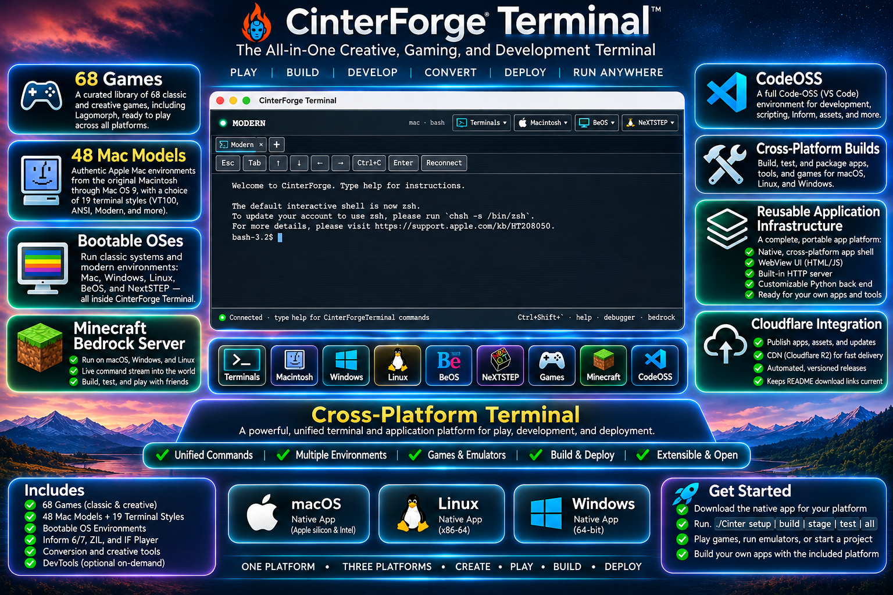

# CinterForge Terminal



<!-- CINTERFORGE:DOWNLOADS:START -->
## Download CinterForge Terminal

#### Current Release Status: Public Alpha
Builds Working, Missing Features, Known Blockers

- [macOS — Apple silicon](https://cinterforge.ucreg.io/CinterForgeTerminal/Distribution/2026.11.23/CinterForgeTerminal-mac-2026.11.23.zip)
- [Windows — x64](https://cinterforge.ucreg.io/CinterForgeTerminal/Distribution/2026.11.23/CinterForgeTerminal-win-2026.11.23.zip)
- [Linux — x64]((https://cinterforge.ucreg.io/CinterForgeTerminal/Distribution/2026.11.23/CinterForgeTerminal-linux-2026.11.23.zip))

The [release manifest](https://cinterforge.ucreg.io/CinterForgeTerminal/Distribution/2026.11.23/four-artifacts.json) contains checksums and includes the separate, optional DevTools archive. `./Cinter publish public` updates these links after public download verification; if CDN propagation is delayed, `./Cinter verify public` completes the update once verification succeeds.

Build Status Details can be found here:
[CinterForgeTerminal Beta Checklist](docs/CinterForgeTerminal%20Beta%20Checklist.md)

<!-- CINTERFORGE:DOWNLOADS:END -->

**Play the classics. Explore computer history. Run real terminals. Build something new.**

CinterForge Terminal brings games, historical computers, Minecraft server management, development tools and a reusable native application platform into one tabbed desktop experience. The app runs on **macOS, Windows and Linux**. It offers simple typed commands for play and exploration, with **Code-OSS** and platform shells when you're ready to create.

| Explore | Play | Create | Run | Deliver |
|---|---|---|---|---|
| **48** classic-Mac emulator configurations + **19** terminal styles | **68** game commands + **16** interactive-fiction titles | Code-OSS, local files and real shells | Minecraft Bedrock Dedicated Server with a live command console | Cross-platform builds and Cloudflare publishing |

*Catalog counts describe configured entries, not a promise that every third-party operating-system image or game is bundled or licensed for redistribution. Some experiences require external media, a network connection, or optional tooling.*

## What can you do with it?

### Play 68 games

Type `games` to explore the catalog. `wargames` opens **JOSHUA**, the WarGames-inspired experience; the other 67 game entries point to classic Macintosh titles such as **SimCity**, **Loom**, **Marathon** and **Prince of Persia**, using their appropriate player or emulator. Type `stories` to discover **16** separate interactive-fiction titles. And `lagomorph` opens the dedicated classic-Mac easter egg.

### Explore classic computers

Browse **48 classic Macintosh emulator configurations** and **19 visual terminal styles** in the configured history collection. Discover the look and feel of systems such as **Apple II**, **VT100**, **IBM PC**, **BeOS**, **NeXTSTEP** and classic Macintosh models. Terminal styles recreate a visual experience; a bootable emulator uses its actual machine runtime and available media. They are not interchangeable.

### Run a Minecraft Bedrock server—and control it live

Manage the official **Minecraft Bedrock Dedicated Server**, including world selection, start/stop and server status. The interactive Bedrock Session streams actual server output and accepts console commands. Run `minecraft` to attach an additional console to a server that is **already running**. On macOS, the managed LinuxKit/Rosetta environment hosts the server and the LAN relay exposes supported game traffic; other platforms use their supported runtime paths. The official server is obtained separately after license acceptance.

### Open Code-OSS and work on local projects

Type `code` to open the Code-OSS development workbench. Work with local folders and workspaces, edit and save source files, and use integrated **real** Mac, Windows or Linux shells when their execution environments are available. The editor and game experiences share one native application, without turning a terminal theme into a simulated operating system.

### Build and distribute across platforms

For developers, `./Cinter` manages **Setup → Build → Stage → Test** for the macOS, Windows and Linux applications and the separate optional DevTools package. Setup provisions required tools and performs preflight checks; lifecycle results are written to persistent logs. Publishing is a **separate explicit command** and can use Cloudflare R2/CDN to distribute versioned application releases and selected content.

### Reuse the application foundation

The same foundation can host other interactive applications: a **native cross-platform WebView shell**, an **authenticated local HTTP service**, a **customizable Python backend**, native menus and process/terminal services, and a JavaScript-to-native bridge. The C++ Host library and stable `cph_*` ABI are available to integrators; `./Cinter` is the public lifecycle CLI. This is infrastructure for builders, not a claim that arbitrary web pages receive unrestricted local-machine access.

## Get started

Download the application for your platform above and extract it. Open the native launcher appropriate to your operating system. The core Terminal and its game/history interface do not require the separate full DevTools package.

Try these commands inside a regular Terminal Session:

```text
help             Show supported commands
games            List the 68 game commands
wargames         Open JOSHUA
stories          Explore interactive fiction
infinite-mac     List classic Macintosh game commands
lagomorph        Open the protected classic-Mac experience
bedrock help     See Minecraft Bedrock management commands
code             Open Code-OSS
```

To start a Minecraft world, follow `bedrock eula`, `bedrock install`, and `bedrock run "<world name>"` when prompted and authorized. `minecraft` **attaches to the running server**; it does not start one.

See the **[User Manual](docs/User%20Manual.md)** for installing, finding games, using the museum, working in Code-OSS, managing worlds and understanding optional development tooling.

## How it works

| Component | What it provides |
|---|---|
| **Native Terminal app** | One tabbed window using WKWebView (macOS), WebView2 (Windows) or WebKitGTK (Linux) |
| **Web application** | Shared HTML, CSS and JavaScript interface, game catalog, historical profiles and guest controls |
| **Python service** | Authenticated loopback HTTP APIs for sessions, services, worlds and supported app actions |
| **Native Host** | Process and terminal I/O, platform menus, WebView bridge, supervision and reusable C/C++ integration |
| **Code-OSS** | Source editing, local workspaces and development-oriented terminal integration |
| **Cinter lifecycle** | Repeatable Setup, Build, Stage, Test and separately authorized Publish / Verify |
| **Cloudflare** | Versioned public distribution through R2/CDN; private development content stays separate |

## Build from source

On the supported macOS producer, with Xcode installed:

```sh
./Cinter all all
```

This runs **Setup → Build → Stage → Test**. It does **not** publish. Setup owns preflight and dependency provisioning; Test owns automated regressions and the applicable native acceptance checks. Full logs and PASS/FAIL summaries are saved beneath sibling `Builds/Logs/CinterForgeTerminal/Lifecycle/` instead of disappearing from the console. Target-native Windows and Linux GUI acceptance require the actual target environments.

To publish a verified release explicitly:

```sh
./Cinter publish public
./Cinter verify public
```

After public verification, the publisher updates the **managed download section at the top of this README** with the new macOS, Windows and Linux links. It does not automatically commit or push the README to Git.

## Documentation

- [User Manual](docs/User%20Manual.md) — product features, first steps and complete command workflows
- [Games and Experiences](docs/Game%20Catalog.md) — all game commands, 16 stories and Lagomorph
- [Architecture](docs/Architecture.md) — native Host, WebViews, Python, services and platform boundaries
- [Build and Release](docs/Build%20and%20Release.md) — lifecycle phases, four release archives and publication
- [Developer Tooling](docs/Developer%20Tooling.md) — optional toolchain installation and real platform terminals
- [Integrating the Host](docs/Integrating%20the%20Host.md) — reusable Host library, authenticated bridge and C API
- [Contributing](docs/Contributing.md) — working on the open-source source tree

## Licenses, content and security

CinterForge Terminal source, external game media, historical operating-system images, JOSHUA and the official Minecraft Bedrock server may have **different licenses and redistribution terms**. Availability of an interface or catalog item does not imply that third-party content is bundled. The local service binds to loopback and authenticates its control API; do not expose it as an unrestricted public service. Build artifacts, caches, worlds and lifecycle logs remain outside the authored source tree in their designated `Builds` or `steamapps` locations.
