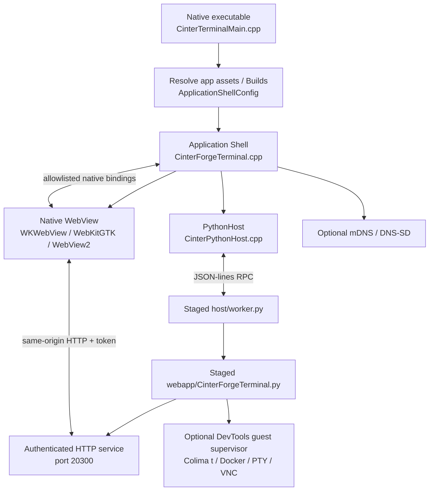

# CinterForge Terminal — Native Application Shell (C++)

**Implementation:** `app/src/CinterForgeTerminal.cpp`, `app/src/support/CinterTerminalMain.cpp`, `app/src/support/CinterPythonHost.cpp`, `app/src/support/CinterPythonHostC.cpp`, `app/src/support/CinterZeroconf.cpp`, and `app/include/`.  
**Build:** repository-root `CMakeLists.txt`; Xcode integration at `app/CinterForgeTerminal.xcodeproj/` and `app/build/xcode/`.  
**Scope:** architecture of the current source in this repository, followed by a *proposed* refactor. No refactor is implemented by this document.

## Purpose and boundary

The native layer provides one cross-platform **Application Shell**: a window and real OS WebView, supervised Python RPC/HTTP service, authorized JavaScript-to-native callbacks, clipboard and native menus, process ownership, and optional LAN discovery. It does **not** implement the game, Bedrock, Code-OSS, shell UI or VM provisioning. Those belong to the served JavaScript and Python application. `CinterForgeTerminal` is the application; `CinterForgePythonHost` and its C ABI are reusable infrastructure.

## Current source map

| Code | Current responsibility |
| --- | --- |
| `app/src/support/CinterTerminalMain.cpp` | Executable entry, platform arguments, release/Builds location resolution, Mac runtime paths, native stdout/stderr logging; calls `runApplicationShell()` |
| `app/src/CinterForgeTerminal.cpp` | Native UI process orchestration: worker/HTTP readiness, WebView creation, JS bindings, native menus and clipboard, native debugger, reboot, shutdown and process-loss handling |
| `app/include/CinterApplicationShell.h` | `ApplicationShellConfig`, `smokeWebViewJavaScript()`, `runApplicationShell()` interface |
| `app/src/support/CinterPythonHost.cpp` | Owns out-of-process Python worker, JSON-lines request/response, timeouts and lifecycle via `PythonProcess` / `PythonHost` |
| `app/src/support/CinterPythonHostC.cpp` | Stable `cph_*` C ABI for the Host, declared in `app/include/CinterPythonHostC.h` |
| `app/src/support/CinterZeroconf.cpp` | Optional DNS-SD/mDNS discover/advertise implementation declared in `app/include/CinterZeroconf.h` |
| `app/include/CinterHostUtilities.h` | Generic message queue/dispatcher utilities, not an alternative application shell |
| `app/build/terminal_bootstrap/main.cpp` | Small upstream WebView bootstrap sample, separate from the Terminal application |
| `app/build/resources/` | Authored icons, installer assets; build output stays outside the checkout |
| `app/CinterForgeTerminal.xcodeproj` | Existing Xcode front-end to the **same** `./Cinter` native build and staged app, not a separate compiler implementation |

`app/src/CinterForgeTerminal.cpp` is the former shell implementation under its current name. Its public declaration still lives in `CinterApplicationShell.h`; do not invent a second `CinterForgeTerminal.h` just to match the new filename.

## Architecture diagram

The RPC worker is **not** the HTTP server: it supervises the application service through the Host IPC. The WebView exchanges user-facing requests with the actual HTTP listener rather than calling Python functions directly.

## Startup and data flow

1. `main()` parses CLI arguments and resolves packaged `Builds`-shaped resources and the verified Python interpreter, worker and service paths. Developer Debug uses sibling `Builds`; packaged apps resolve embedded resources without writing into the signed bundle.
2. `runApplicationShell()` validates those inputs and starts one `PythonHost` child, which imports the staged Python service through `host/worker.py`.
3. The native shell issues the service `start` RPC with the resolved Builds path. The Python service binds or securely attaches to the Terminal HTTP listener and returns its URL and native bootstrap grant.
4. Only after HTTP readiness does C++ create/navigate the native WebView. The served page loads `webapp/index.html`, `terminal.js`, CSS and authorized API endpoints.
5. The bridge registers native actions such as `cinterWindow`, `cinterClipboard` and `cinterConnect`. On macOS, the real system menu and Safari inspector integration are attached to the existing WebView; Windows/Linux retain their respective platform adapters.
6. Session creation, PTY input/output, Code-OSS, games, VNC readiness, and guest boot activity happen **behind** the HTTP API. A JS menu click does not itself establish a guest connection; verified Python guest state controls availability.

**Typical request path:** UI input → authenticated `/api/terminal/input` → server-owned `TerminalSession`/PTY → buffered output → `/api/terminal/poll` → UI renderer. Native menu events can reach JS by the restricted `window.eval` path, but ordinary terminal data does not traverse the C++ JSON-lines bridge.

**Failure ownership:** failure to start Python or HTTP is a native launch failure; failure of optional DevTools guests must be surfaced in Server Log without blocking Mac Bash. C++ must not infer that VNC, Linux Bash, or Windows Bash is connected simply because a native window exists.

## Shutdown, crash, and reboot

Closing the window ends `window.run()`. The shell stops the HTTP service via its `stop` RPC, asks the runtime owner to perform `shutdown_runtime` for app-owned guests, and stops the Python worker. A separate runtime watchdog covers abnormal native termination, including Xcode Stop. A remote/attached window is not entitled to stop a server or VM it does not own. An app reboot waits for the old HTTP owner to release port 20300 before spawning the replacement. A server-only reboot uses a replacement worker and attempts recovery if it fails. Shutdown errors should be logged rather than hidden, but must not leave a second, orphaned VM owner.

## Refactor proposal — do not implement yet

The present shell file combines platform-native UI, HTTP worker lifecycle, WebView bridge, menus, clipboard, LAN spawning, inspector and reload logic. Refactor **by ownership**, keeping one implementation and preserving its existing C API:

| Proposed component | Owns | Contract |
| --- | --- | --- |
| `CinterForgeApplicationShell` | Startup state machine, owner vs attached window, shutdown ordering | Existing `ApplicationShellConfig` / `runApplicationShell` |
| `CinterForgeythonServiceHost` | Only RPC worker lifecycle and readiness | Existing `PythonHost`, `start`, `stop`, `service_health` |
| `CinterForgeWebViewBridge` | Restricted native JS binding registration and callbacks | Explicit allowlisted actions; trusted-origin checks |
| `CinterForgePlatformMenu` | System menus, clipboard, debugger/window integration | One shared menu model with Mac/Win/Linux implementations |
| `CinterForgeApplicationPaths` | Developer vs installed paths and log destinations | No hardcoded checkout location; authored vs generated separation |
| `CinterForgeDiscovery` | Advertise and browse current listener | Existing `CinterZeroconf` ABI; no alternate discovery service |

**Sequence:** first document public C ABI, C++ config and JS binding names; then extract one implementation at a time from the existing source while keeping the `CMakeLists.txt` targets and Xcode build phase unchanged. Do not introduce a second shell, rewrite native entry points, duplicate platform code, or move dependencies into Stage/Runtime. Use the existing lifecycle and real app launch to confirm each change before proceeding to the next boundary.

## Current fault boundaries worth keeping visible

- **Python worker failed** (native RPC or HTTP never ready) is different from **guest VM failed**, **guest Bash PTY failed**, and **VNC endpoint failed**.
- Xcode Debug invokes the same Cinter Build/Host Stage path as CLI; it must resolve `PROJECT_DIR` at `app/` while sibling generated output remains `<repo>/../Builds`.
- A successfully opened WebView is not proof of a working guest terminal, VNC desktop, or staged Linux/Windows GUI executable.
- Logs should preserve live subprocess messages under `Logs/CinterForgeTerminal` for the relevant developer or Steam context, with clear owner, component, attempt and exit status.

**Related:** [JavaScript client](../webapp/CinterForgeTerminalClient.md), [Python server](../webapp/CinterForgeTerminalServer.md), [repository architecture](../docs/Architecture.md), [build and release](../docs/Build%20and%20Release.md).
