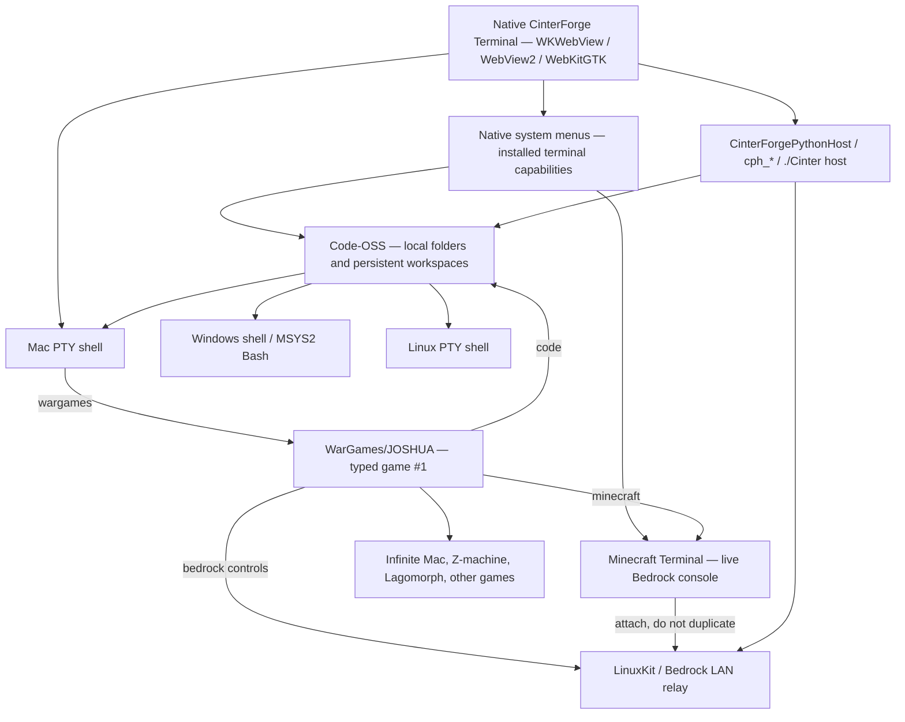

# Architecture

CinterForge Terminal is **one native product with existing Session tabs**, typed game commands, a Code-OSS workbench, and a reusable cross-platform native Host. A game is launched from a normal shell Session by its registered name, without a separate Game-mode menu. Platform Bash and development work also have Code-OSS integrated terminals.

## Terminal Session backends and typed games

| Mode | Entry point | Responsibility |
|---|---|---|
| **WarGames / JOSHUA** | Type `wargames` in a shell Session | The original JOSHUA application is game #1 of the 68-game list and opens in a new Session tab; there is no Game-mode menu option. |
| **Minecraft** | `minecraft`; native **New Minecraft Terminal** | A live, reconnectable, interactive console attached to the **existing running** managed Bedrock server. Does not silently create another server. |
| **Mac** | Native **New Mac Bash** Session (unlimited); Code-OSS Mac shell | Real macOS POSIX PTY. Mac shells do not require DevTools. |
| **Win** | Code-OSS **Open Windows Bash** only (one integrated terminal) | Real guest MSYS2 Bash under Wine, never a Session Bash tab. |
| **Linux** | Code-OSS **Open Linux Bash** only (one integrated terminal) | Real managed Linux Bash, never a Session Bash tab. |

**Native launch / DevTools readiness.** Without verified DevTools the normal Mac Bash
Session appears immediately. With DevTools, a lightweight **Initializing DevTools...**
splash is the only initial WebView page while the app-owned supervisor starts
Colima and verifies both Linux and Windows Bash guests. It does not provision
or download anything and does not create guest Session tabs. Success opens the
normal Mac Bash Session; failure or an unresponsive supervisor also opens Mac
Bash with the error retained in the Server log. One failing guest does not
invalidate a verified other guest: the Linux Code-OSS Bash can stay operational
when Wine/MSYS2 Windows Bash fails. The splash is bounded and never blocks
local Mac Bash indefinitely. Completing an explicitly authorized DevTools
installation requests one native app relaunch to enter the same startup check;
the installer never spins up another VM in its own PTY. All Bash shells identify
the real interactive user, host and working directory in the prompt.

The default Code-OSS terminal layout on macOS is **Mac Bash + Server Log**, plus **one Linux and one Windows Bash only when verified DevTools is installed**; Windows and Linux app builds start with **one native terminal only**. A missing platform environment is reported and can be provisioned through the documented toolchain flow; it is never simulated or silently labeled "installed." Mac Bash and Launcher requests create or focus Sessions in the **existing app window**, not new application windows. Windows/Linux Bash exist only inside Code-OSS and each reopens/focuses its single integrated terminal. Typing a game name opens the relevant existing game/player in a new Session rather than a separate app window. **Mac Bash uses the native PTY directly and never requires DevTools.** Selecting Win/Linux Bash on macOS checks the separately installed unified DevTools receipt, offers explicit opt-in download with actual size, installation destination and progress only if absent, and connects a real guest shell from that SDK; it never uses a relabeled Mac Bash. The terminal-owned runtime VM is separate from the managed Setup VMs.

## LAN remote development and Discord

One Terminal-owned Python HTTP server serves the existing full UI and its
PTY/ConPTY/Host RPC on private LAN port **20300**, with session login before
remote content or APIs are served. Its local native WebView uses loopback and
the existing per-process token; remote browsers have an additional session
cookie and the same per-origin API token. There is no separate remote-only UI,
backend, proxy, or fake shell.

**Bonjour/DNS-SD** over multicast UDP 5353 advertises the existing Terminal
HTTP server on **20300**, as `_http._tcp.local.`. The shared Host implementation
`CinterZeroconf` publishes PTR, SRV, TXT and A records (actual LAN IP and port),
with TXT `suite=cinterforge`, `app=terminal`, `path=/`. Every CinterForge
consumer browses `_http._tcp.local.` and lists qualifying service records,
not just other Terminals. The common CinterForge HTTP port namespace is
**20300–20399**: Terminal **20300**, Converter **20310**, OS **20320**, and
WebApp **20380**. Other apps advertise their **actual listener** using the
same DNS-SD type and TXT keys; only services that publish these records can
appear. No custom 20301 discovery listener or central registry is needed.
Other products can use the exported Host `czc_publish_txt` C ABI or the existing
`cinter-zeroconf --publish --app converter --name "CinterForge Converter" --port 20310`
command, running for the lifetime of their actual HTTP listener.

The Terminal native File menu and HTML LAN dropdown show the discovered
CinterForge services and open their advertised HTTP URLs in independent native
windows (or ordinary browser tabs), preserving the active local Terminal.
Connecting to a Terminal provides its existing remote development login and
host PTY/ConPTY sessions. The HTTP listener accepts LAN Host headers and mDNS
aliases; it does not use the Host header as authentication. The existing remote
login still applies to non-loopback requests. HTTP is **not** SSH/TLS; use on
a trusted development LAN or through a separately secured tunnel, not a
public Internet port forward.

The `discord` shell command asks the authenticated host backend to resolve the
configured `discord_dev` bot, guild and text channel through Discord's HTTPS
API. The browser receives only sanitized channel metadata and messages; token
and secret values stay server-side. A Discord tab is a distinct Session view
and cannot overwrite the command's shell or another IF/game interpreter.

## Native system menus, not HTML menus

The macOS system menu and Code-OSS menu show the same **File / Edit / Selection / View / Go / Run / Terminal / Help** headings and command labels in both modes. Code-OSS-only actions remain **visible but disabled** outside the workbench, never silently disappearing; valid Terminal commands stay active. The Terminal menu opens Mac Bash Sessions, one Code-OSS integrated Windows/Linux Bash per platform, and the singleton Mac/Windows/Linux Launcher Sessions. Only one Code-OSS Session can exist. Reopening it focuses the existing workbench without reloading or reallocating its PTYs.

On a Mac host, Mac Bash and Mac Launcher work without DevTools. Windows/Linux Bash
and graphical Launchers appear in the menus as disabled until the verified
optional DevTools receipt is installed. On native Windows/Linux installs, only
that host's own shell is enabled; off-platform Bash and all three graphical
Launcher entries remain visible but disabled. Native Windows/Linux applications
do not start macOS-managed Colima sessions or offer fake remote terminals.
The common Launcher tabs within a Mac host still have one staged product icon:
Mac opens the staged .app externally; Linux and Windows open their respective
staged applications inside their existing managed guest windows.

The web UI mirrors the same menu model for platforms without native menus; it is not a second independent command list. Game catalog and museum navigation remain content controls. Native copy, paste, focus, keyboard, selection, dialog, and debugger behaviors remain available when embedded emulators take focus.

## Game and museum runtime

The original, separately launched JOSHUA application retains the full greeting and built-in Tic-Tac-Toe, Hangman, Sudoku and fictional Global Thermonuclear War game modes, along with typing cadence, EN/IT presentation, browser speech, synthesized sounds, keyboard accessibility and reduced-motion behavior; no new speech subsystem or wholesale redesign is required. Commands resolve through the authoritative game and platform catalogs to real players, emulators or services. `help`, `games`, `wargames`, `stories`, `infinite-mac`, individual game aliases, `lagomorph`, `bedrock`, `minecraft`, and `code` have distinct, documented outcomes.

The Computer History Museum retains **VT100, Apple II, IBM PC/DOS/PowerShell, BeOS, NeXTSTEP, Macintosh models and Code-OSS** where their runtimes/profiles are supplied. Historical profiles stay in chronological release order and retain keyboard, mouse and return navigation. A historical skin and a real emulated machine are represented distinctly.

Interactive fiction runs in the staged JavaScript Z-machine with externally acquired story binaries and independently persistent CONV/Quetzal saves. Classic Mac experiences use Infinite Mac and their declared machine/media profiles. **Lagomorph** retains the working Quadra 650 experience: its special command, original application/resource forks, disk and Battles images, icon, manual, Finder arrangement, entry/exit controls, local serving and independent publishing paths. Generalized game dispatch must call this implementation, not replace it.

## Code-OSS, folders and the entire Cinter lifecycle

`code` opens the actual Code-OSS workbench. Users can select an ordinary local folder, open or save a multi-root workspace, browse nested directories, edit any permitted local file, and retain the selected workspace/folder when the workbench and Terminal close and reopen. Workspace persistence, file read/write, dialogs, trust and permissions are provided by explicit native/Host interfaces, not by exposing an unrestricted loopback filesystem API.

When **CinterForgeTerminal** is the loaded folder/workspace, Code-OSS recognizes that repository through its verified root/manifest and exposes the repository's **real `./Cinter` lifecycle** in its integrated terminals: inspect/status, Setup, Build, Stage, Test, `all all`, explicit Publish, and fetch as supported. On a macOS producer, the lifecycle can produce all **three native targets** and the unified DevTools release. `./Cinter all all` never implicitly publishes. The editor, workspace and installed Terminal use the same staged Host/CLI contracts; they do not fork a second implementation of build operations.

The `devtools install|uninstall|list|report` command family is available in developer integrated terminals. It manages the optional verified **single unified three-platform** DevTools distribution. `report` produces a Markdown toolchain and version report under `Builds/Logs`, and can be opened in Code-OSS. General Bash/PowerShell, compilers, debuggers and `./Cinter` commands belong to the native Mac Bash Session or real Code-OSS integrated shells, not to JOSHUA's game input. Mac, Windows and Linux Launchers are closed by default and created on demand; one per platform, sharing a lightweight guest graphical session (Windows via Wine), not KDE. Each Launcher has one CinterForge Terminal icon and its own replaceable background PNG. The icon launches only the matching verified Steam Stage: macOS `.app` outside the WebView, Linux `Terminal.sh` inside the Linux guest, Windows `Terminal.cmd` under Wine inside the Windows guest. No additional app catalog or launcher mode badge is shown. Graphical applications launched from Code-OSS Bash or Debug use their platform Launcher display.

## Native application shell and reusable Host

The native shell uses the pinned [`webview/webview`](https://github.com/webview/webview) abstraction with platform implementations:

| Target | Native WebView | Platform shell/process |
|---|---|---|
| macOS | Cocoa / `WKWebView` | macOS PTY and signed `.app` |
| Windows | Win32 / WebView2 | Windows ConPTY and staged MSYS2 Bash |
| Linux | GTK / WebKitGTK | POSIX PTY and Linux process services |

`src/CinterApplicationShell.cpp` owns the native shell and menu adaptation. The Host retains its **`CinterForgePythonHost`** C++ library, **`cph_*`** C ABI and **`./Cinter host ...`** lifecycle interface. It supplies native WebViews, PTY/ConPTY session management, HTTP/client transport (`cinter-curl`), supervised Python services, authenticated JS/native bridge, readiness, events, timeouts, cancellation, process lifetime, optional discovery and an optional Steam HTML-surface adapter. The core does not require Steam and does not grant arbitrary LAN access or filesystem execution.

Native WebView inspectors use the real browser-engine debugging support, with native menu access and the `debugger` developer command in Code-OSS. Merely evaluating a JS `debugger;` statement is not equivalent to opening an inspector.

## Bedrock and managed virtual machines

Bedrock is a normal user-requested game service: the official Bedrock Dedicated Server is installed only after explicit EULA acceptance. On macOS, it runs in the existing signed LinuxKit/Rosetta runtime with an unprivileged host LAN relay forwarding supported game and discovery ports. This does not provide a bridged guest IP and does not require the restricted `com.apple.vm.networking` entitlement. `bedrock start` discovers worlds, `bedrock run <world>` opens a dedicated **Bedrock** Session tab that owns the server process and two-way PTY, leaving the requesting Session unchanged. `bedrock run ""` reuses the selected world; repeated run requests reselect the live Bedrock Session rather than starting a second VM. `minecraft` opens a separate client console for the same running server. Closing a Minecraft client console detaches; closing the server-owning Bedrock tab or `bedrock stop` stops the server; closing the owning Terminal stops its managed Bedrock guest and helpers. User worlds and unrelated VMs are preserved.

A macOS **producer Setup** uses **`c`** only for the LinuxKit ARM64 kernel and guest inputs (glibc/NetherNet); after Minecraft/Bedrock acceptance it releases `c` and starts **`t`**, the dedicated QEMU x86-64 guest for the single shared Debian Linux/Windows build/runtime image, Bash sessions and both VNC desktops. The AMD64 Docker image must never be installed through `c` or ARM64 user-space translation. Mac Bootstrap provisions the tools, including a pinned prebuilt native macOS ARM64 QEMU `qemu-system-x86_64` and `qemu-img` closure, without starting a VM; LinuxKit Setup starts `c` only when needed. The managed VM-hosting Lima binary has an appropriately verified Apple Virtualization entitlement, and all VM disks, caches and logs stay in sibling `Builds/CFTVM`. Setup starts and stops only its owned VMs; it does not adopt CFOS's unrelated VM or require a consumer app to run developer Setup. The installed application's normal game VMs belong to its own runtime lifetime, not the producer lifecycle.

With a verified optional DevTools receipt, native Mac launch holds exactly one
runtime `t` Colima VM, one Linux and one Windows/Wine guest container, **one
persistent interactive Bash PTY inside each**, and one monitored X11/VNC/noVNC server
inside each guest. Code-OSS terminal tabs **attach/detach** from those PTYs;
they cannot create additional guest Bash processes. The Linux/Windows Launcher
Sessions use VNC only, not guest Bash. Linux/Windows Code-OSS access remains
unavailable when DevTools is absent; host-native Mac functionality is unaffected.
An independent native-PID watchdog owns runtime crash cleanup, stopping the
verified owned guest containers and VM after normal Quit or unexpected native
termination. Setup proves these same startup paths and their shutdown without
leaving the owned `t` or `c` VM running; Test validates the Setup receipt offline.

The custom LinuxKit VirtioFS kernel, guest image, signed virtualization launcher and host LAN relay and Bedrock probe are produced/verified by Terminal Setup. That Setup runs **real, isolated, explicitly licensed official Bedrock acceptance** using disposable state and stops it. A user-facing application never implicitly downloads or starts Bedrock on startup.

## Repository boundaries, release and security

Authoritative Terminal source is in `CinterForgeTerminal`; other repositories retain their own products. The shared artifact boundary is sibling `<repo>/../Builds` with exact versions/hashes/target ABIs; installed assets and player data belong to the declared `steamapps` tree. No cross-repository source imports, hidden generated caches in authored repositories, or dependency on a previously warm machine are allowed.

Build records **four unpacked outputs** under sibling `Builds`: Mac, Windows, Linux and unified DevTools. Stage copies and verifies those unpacked outputs directly into Steam with no ZIP/UnZIP. Publish alone creates the four distribution ZIPs; Setup alone downloads, verifies and unpacks published ZIPs into their canonical `Builds` paths when required. Test validates staged products offline, and atomic reboot operations never recompile or package. See [Build and Release](Build%20and%20Release.md).

An optional Steam adapter and permissioned Creative Mesh can consume the Host interfaces without making Steamworks or untrusted inter-app commands core requirements. See [Integrating the Host](Integrating%20the%20Host.md).
