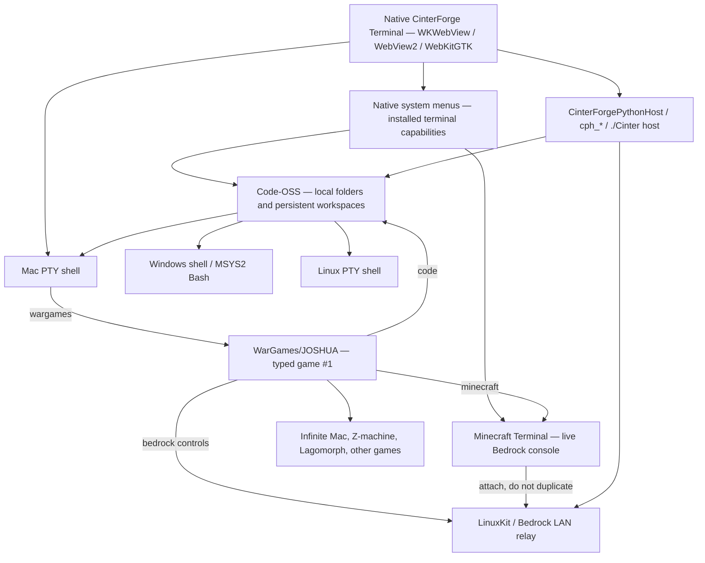

# Architecture

CinterForge Terminal is **one native product with existing Session tabs**, typed game commands, a Code-OSS workbench, and a reusable cross-platform native Host. A game is launched from a normal shell Session by its registered name, without a separate Game-mode menu. Platform Bash and development work also have Code-OSS integrated terminals.

## Terminal Session backends and typed games

| Mode | Entry point | Responsibility |
|---|---|---|
| **WarGames / JOSHUA** | Type `wargames` in a shell Session | The original JOSHUA application is game #1 of the 68-game list and opens in a new Session tab; there is no Game-mode menu option. |
| **Minecraft** | `minecraft`; native **New Minecraft Terminal** | A live, reconnectable, interactive console attached to the **existing running** managed Bedrock server. Does not silently create another server. |
| **Mac** | Native **New Mac Terminal**; Code-OSS default on macOS | Real macOS POSIX PTY inside the Code-OSS workbench. |
| **Win** | Native **New Win Terminal**; Code-OSS default on macOS when installed | Real installed Windows execution environment and shell, with required MSYS2 Bash runtime; a theme is not a substitute. |
| **Linux** | Native **New Linux Terminal**; Code-OSS default on macOS when installed | Real installed Linux execution environment and POSIX shell; a fake prompt is not a substitute. |

The default Code-OSS terminal layout is **Mac + Win + Linux on macOS** and **one native terminal on Windows or Linux**. A missing platform environment is reported and can be provisioned through the documented toolchain flow; it is never simulated or silently labeled "installed." Terminal requests create separate Sessions in the **existing app window**, not new application windows. Typing a game name opens the relevant existing game/player in a new Session rather than a separate app window. **Mac Bash uses the native PTY directly and never requires DevTools.** Selecting Win/Linux Bash on macOS checks the separately installed unified DevTools receipt, offers explicit opt-in download with actual size, installation destination and progress only if absent, and connects a real guest shell from that SDK; it never uses a relabeled Mac Bash. The terminal-owned runtime VM is separate from the managed Setup VMs.

## LAN remote development and Discord

One Terminal-owned Python HTTP server serves the existing full UI and its
PTY/ConPTY/Host RPC on private LAN port **20300**, with session login before
remote content or APIs are served. Its local native WebView uses loopback and
the existing per-process token; remote browsers have an additional session
cookie and the same per-origin API token. There is no separate remote-only UI,
backend, proxy, or fake shell. UDP port **20301** answers bounded LAN discovery
requests; the native system menu and existing HTML dropdown show those peers.
Selecting a peer spawns a separate native WebView process/window pointed at
that host, without starting a duplicate local Python server. Shell, debug and
build execution occurs on the host and is limited by its OS account. HTTP is
not SSH/TLS: only trusted private LAN or a separately secured tunnel is in
scope, not public-internet exposure.

The `discord` shell command asks the authenticated host backend to resolve the
configured `discord_dev` bot, guild and text channel through Discord's HTTPS
API. The browser receives only sanitized channel metadata and messages; token
and secret values stay server-side. A Discord tab is a distinct Session view
and cannot overwrite the command's shell or another IF/game interpreter.

## Native system menus, not HTML menus

The operating-system menu bar owns **File**, **Edit**, and the **New … Terminal** commands. Native **New Minecraft / Mac / Win / Linux Terminal** entries are driven from the application's verified installed terminal capabilities. The set remains stable across page transitions, embedded game views, focus changes, and Code-OSS launches. A requested but unavailable platform receives an actionable installation explanation rather than a temporary menu entry that later disappears.

The web UI contains **no competing JavaScript Terminal or Edit menu**. Game catalog and museum navigation are content controls, not a shadow copy of the native system menu. Native copy, paste, focus, keyboard, selection, dialog, and debugger behaviors remain available when embedded emulators take focus.

## Game and museum runtime

The original, separately launched JOSHUA application retains the full greeting and built-in Tic-Tac-Toe, Hangman, Sudoku and fictional Global Thermonuclear War game modes, along with typing cadence, EN/IT presentation, browser speech, synthesized sounds, keyboard accessibility and reduced-motion behavior; no new speech subsystem or wholesale redesign is required. Commands resolve through the authoritative game and platform catalogs to real players, emulators or services. `help`, `games`, `wargames`, `stories`, `infinite-mac`, individual game aliases, `lagomorph`, `bedrock`, `minecraft`, and `code` have distinct, documented outcomes.

The Computer History Museum retains **VT100, Apple II, IBM PC/DOS/PowerShell, BeOS, NeXTSTEP, Macintosh models and Code-OSS** where their runtimes/profiles are supplied. Historical profiles stay in chronological release order and retain keyboard, mouse and return navigation. A historical skin and a real emulated machine are represented distinctly.

Interactive fiction runs in the staged JavaScript Z-machine with externally acquired story binaries and independently persistent CONV/Quetzal saves. Classic Mac experiences use Infinite Mac and their declared machine/media profiles. **Lagomorph** retains the working Quadra 650 experience: its special command, original application/resource forks, disk and Battles images, icon, manual, Finder arrangement, entry/exit controls, local serving and independent publishing paths. Generalized game dispatch must call this implementation, not replace it.

## Code-OSS, folders and the entire Cinter lifecycle

`code` opens the actual Code-OSS workbench. Users can select an ordinary local folder, open or save a multi-root workspace, browse nested directories, edit any permitted local file, and retain the selected workspace/folder when the workbench and Terminal close and reopen. Workspace persistence, file read/write, dialogs, trust and permissions are provided by explicit native/Host interfaces, not by exposing an unrestricted loopback filesystem API.

When **CinterForgeTerminal** is the loaded folder/workspace, Code-OSS recognizes that repository through its verified root/manifest and exposes the repository's **real `./Cinter` lifecycle** in its integrated terminals: inspect/status, Setup, Build, Stage, Test, `all all`, explicit Publish, and fetch as supported. On a macOS producer, the lifecycle can produce all **three native targets** and the unified DevTools release. `./Cinter all all` never implicitly publishes. The editor, workspace and installed Terminal use the same staged Host/CLI contracts; they do not fork a second implementation of build operations.

The `devtools install|uninstall|list|report` command family is available in developer integrated terminals. It manages the optional verified **single unified three-platform** DevTools distribution. `report` produces a Markdown toolchain and version report under `Builds/Logs`, and can be opened in Code-OSS. General Bash/PowerShell, compilers, debuggers and `./Cinter` commands belong to real shell Sessions, not to JOSHUA's game input.

## Native application shell and reusable Host

The native shell uses the pinned [`webview/webview`](https://github.com/webview/webview) abstraction with platform implementations:

| Target | Native WebView | Platform shell/process |
|---|---|---|
| macOS | Cocoa / `WKWebView` | macOS PTY and signed `.app` |
| Windows | Win32 / WebView2 | Windows ConPTY and staged MSYS2 Bash |
| Linux | GTK / WebKitGTK | POSIX PTY and Linux process services |

`src/CinterApplicationShell.cpp` owns the native shell and menu adaptation. The Host retains its **`CinterForgePythonHost`** C++ library, **`cph_*`** C ABI and **`./Cinter host ...`** lifecycle interface. It supplies native WebViews, PTY/ConPTY session management, HTTP/client transport (`cinter-curl`), supervised Python services, authenticated JS/native bridge, readiness, events, timeouts, cancellation, process lifetime, optional discovery and an optional Steam HTML-surface adapter. The core does not require Steam and does not grant arbitrary LAN access or filesystem execution.

Native WebView inspectors use the real browser-engine debugging support, with native menu access and the `debugger` developer command in Code-OSS. Merely evaluating a JS `debugger;` statement is not equivalent to opening an inspector.

## Bedrock and managed virtual machines

Bedrock is a normal user-requested game service: the official Bedrock Dedicated Server is installed only after explicit EULA acceptance. On macOS, it runs in the existing signed LinuxKit/Rosetta runtime with an unprivileged host LAN relay forwarding supported game and discovery ports. This does not provide a bridged guest IP and does not require the restricted `com.apple.vm.networking` entitlement. `bedrock start` discovers worlds, `bedrock run <world>` opens a dedicated **Bedrock** Session tab that owns the server process and two-way PTY, leaving the requesting Session unchanged. `bedrock run ""` reuses the selected world; repeated run requests reselect the live Bedrock Session rather than starting a second VM. `minecraft` opens a separate client console for the same running server. Closing a Minecraft client console detaches; closing the server-owning Bedrock tab or `bedrock stop` stops the server; closing the owning Terminal stops its managed Bedrock guest and helpers. User worlds and unrelated VMs are preserved.

A macOS **producer Setup** uses separately managed short-path Colima profiles: **`w`** for the Windows cross-build/Docker/LinuxKit kernel build substrate, and **`c`** for ARM64 Ubuntu guest-input provisioning (glibc/NetherNet). The managed VM-hosting Lima binary has an appropriately verified Apple Virtualization entitlement, and all VM disks, caches and logs stay in sibling `Builds/CFTVM`. Setup starts and stops only its owned VMs; it does not adopt CFOS's unrelated VM or require a consumer app to run developer Setup. The installed application's normal game VMs belong to its own runtime lifetime, not the producer lifecycle.

The custom LinuxKit VirtioFS kernel, guest image, signed virtualization launcher and host LAN relay and Bedrock probe are produced/verified by Terminal Setup. That Setup runs **real, isolated, explicitly licensed official Bedrock acceptance** using disposable state and stops it. A user-facing application never implicitly downloads or starts Bedrock on startup.

## Repository boundaries, release and security

Authoritative Terminal source is in `CinterForgeTerminal`; other repositories retain their own products. The shared artifact boundary is sibling `<repo>/../Builds` with exact versions/hashes/target ABIs; installed assets and player data belong to the declared `steamapps` tree. No cross-repository source imports, hidden generated caches in authored repositories, or dependency on a previously warm machine are allowed.

Build creates **exactly four** release ZIPs: three independently installable lightweight native apps (Mac/Win/Linux) and one optional unified DevTools archive. Build packages/signs and verifies; Stage only verifies/extracts the completed ZIPs; Test executes genuine installed-product acceptance; Publish is explicit and separate. See [Build and Release](Build%20and%20Release.md).

An optional Steam adapter and permissioned Creative Mesh can consume the Host interfaces without making Steamworks or untrusted inter-app commands core requirements. See [Integrating the Host](Integrating%20the%20Host.md).
