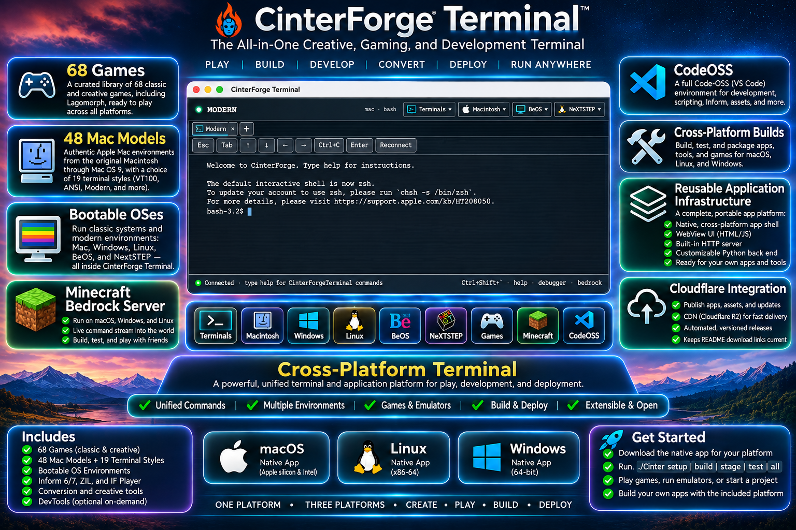

# CinterForge Terminal — User Manual

**Your starting point for games, classic computers, Minecraft, coding and cross-platform development.**

CinterForge Terminal is a native application for **macOS, Windows and Linux**. You start in a tabbed Terminal window; from there, simple commands open game experiences, historic computer configurations, server tools and the Code-OSS workspace. The app also supplies a reusable WebView/Python application foundation for developers.

[Download CinterForge Terminal](../README.md#download-cinterforgeterminal) · [See the games](Game%20Catalog.md) · [Developer Tooling](Developer%20Tooling.md)



## 1. Getting started

1. Download the **macOS Apple-silicon DMG**, **Windows x64 ZIP**, or **Linux x64 ZIP** using the links at the top of the [README](../README.md).
2. On Windows, extract the ZIP and run `CinterForgeTerminal-win.msi` to install the app. On macOS, open the DMG; on Linux, extract the ZIP and launch its native executable. The Terminal launches into its main Session view.
3. The startup Session asks “Shall we play a game?”. Type `yes` to display the same catalog as `games`, or continue using the shell. Type `help` for the short command list, `games` for the catalog, or `bedrock` for Minecraft server commands. `code` and `debugger` are available only after optional DevTools have been installed.
4. Navigate between Sessions using the application tabs. Games and consoles open in their own tabs rather than replacing your original terminal.

### Finding your way around the Terminal

The **entire central area is the Terminal Session**: shell output or the selected
emulator fills that area. There is no permanent Code-OSS panel or navigation
sidebar. The menu bar has Code-OSS **File, Edit, Selection, View, Go, Run,
Terminal and Help** on the left, the current mode in the center, and
**LAN, Macintosh, BeOS, NeXTSTEP and Machines** on the right. The Code
commands are available while Code-OSS is active; outside Code only Quit,
Copy/Paste and the existing CinterForge terminal/computer choices work. Each dropdown row also has a
small category icon. Opened sessions appear in the tab strip with a matching
icon, a tab name, and their own close button. The keyboard shortcuts and
Reconnect buttons stay on the row directly below the tabs.

Icons are decorative: the written names remain the accessible labels, and
opening/closing sessions still uses the same commands and controls.

The three lightweight native applications are separate downloads. A fourth, **optional unified DevTools** archive is only needed for certain development and additional platform environments, not simply to play a game.

### Connect to a Terminal on your LAN

CinterForge Terminal runs its **existing** Python HTTP service on port **20300**
for browsers on the same private LAN. On the host, enter:

```text
setpass <username> <password>
```

This sets **both** LAN login fields using the host's Terminal shell; nothing is
generated by the app. The password is never displayed in the LAN popup, returned
by the LAN information API, or printed by the command's success response. The
login credential record contains only a salted verifier in writable developer
`Builds` or the installed app's `steamapps` state, and survives restarts. Existing remote
logins are invalidated when credentials change. Because this is a real Bash
terminal, the command line you type is visible in the shell and may appear in
the Terminal transcript/session log. The standard Bash shell is configured
not to save `setpass` commands in its history.

Open `http://<host-LAN-IP>:20300/` in another browser. Before `setpass` is
run the HTTP Terminal is open; afterward every ordinary browser (including
`localhost:20300`) must log in with the configured username and password.
The native application itself opens without a browser login.

The **LAN** dropdown lists other discovered CinterForge Terminal instances and
also accepts a private IP address. In the native application, selecting a
listed host opens a **new independent native window** with its WebView pointed
at that host. The native and HTML bars both show **LAN → Connect / Refresh…**. The original local
Terminal remains open.

After login, you get the **host's real terminal**: shell commands, PTY/ConPTY
sessions, Code-OSS, builds, logs and debugger requests execute on that host
under its running OS account. This is remote development access, not a
read-only screen share. Running `./Cinter` still requires the appropriate
source checkout and build prerequisites on the **remote host**. Closing the
connected window does not shut down the host's Terminal server.

**Network boundary:** Port 20300 serves HTTP on private LAN addresses, not an
encrypted SSH transport. Use it only on a trusted LAN or through a secure
tunnel; do not port-forward it to the public internet. Discovery uses
standard Bonjour/mDNS UDP 5353; Terminal advertises HTTP port 20300 and other
CinterForge apps advertise their own 203xx ports. After `setpass`, unauthenticated
browsers cannot use host shell operations.

### Discord tab

From any Terminal shell, type:

```text
discord "Hope AI Dev", "CinterForge Internal", "builds"
```

The command uses the existing **`discord_dev`** provider from the private
`cfdev/config.json` or `dev/config.json` (or `CINTERFORGE_CONFIG`). It must be
enabled and contain a valid bot token. The host resolves the named server and
text channel, then opens a new Discord tab in the same Terminal UI; existing
shells and games stay open. Enter sends a message; the tab displays messages
from the channel. The connector sends **as the configured Discord bot**, not
as an impersonated human account; the first argument is the requested
user/context label. Discord permissions and bot membership must allow reading
and posting in the named channel. Bot tokens never enter browser HTML/JS or
native output logs.

## 2. At a glance

| Feature | What it does | Start with |
|---|---|---|
| **Games** | WarGames/JOSHUA, the actual IF title commands, `infinitemac` and `bedrock`; classic Mac aliases remain callable directly | `games` |
| **16 interactive-fiction titles** | Story-driven text games with a bundled JavaScript Z-machine player | `stories` |
| **47 public museum emulator configurations** | Search and launch the existing Macintosh, NeXTSTEP and BeOS emulators | `infinitemac` / museum menus |
| **19 terminal styles** | Explore historical and modern screen aesthetics, distinct from real OS emulation | Museum / terminal styles |
| **Minecraft Bedrock** | Choose Java or Bedrock worlds, apply a world-specific CinterForge pack, inspect maps, and serve a selected world | `games` → `bedrock` → `bedrock report` |
| **Cross-platform shells** | Actual Mac, Windows and Linux sessions where supported environments are present | Native Terminal menu / Code-OSS |
| **Code-OSS (optional DevTools)** | Edit and save local projects, use integrated terminals and build tools | `code` after installing DevTools |
| **Application platform** | Native WebView shell plus a supervised Python/HTTP backend | [Architecture](Architecture.md) |

The counts come from the checked-in catalog: the game commands, separate interactive-fiction titles, emulator configurations and visual profiles are **different lists**. A style is not a bootable emulator, and historical or third-party media may be separate from the app.

## 3. Commands and help hierarchy

The top-level `help` stays short. Its normal entries are:

```text
Commands:
  games                         List of playable games
  play <title>                  Launch a game (play is optional)

  devtools                      Manage Developer Tools. See devtools help
```

When a valid development configuration grants the corresponding capability, `assets` and/or `discord` appear after `devtools`. When DevTools is **actually installed**, `code` and `debugger` appear after those optional entries. Neither Code-OSS nor the debugger is advertised as installed merely because development credentials exist. The app may also display an ordinary OS-shell reminder.

At the launch question, entering `yes` displays the **same list** as entering `games`. Entering `games` again at any time redisplays it. The catalog shows `joshua` (WarGames) first, each interactive-fiction title loaded from JSON, one `infinitemac` (searchable Macintosh, NeXTSTEP and BeOS emulator gallery), and `bedrock` (Minecraft) last. Every command shown in `games` works directly **or** after `play`: `joshua` / `play joshua`, `zork1` / `play zork1`, `infinitemac` / `play infinitemac`, and `bedrock` / `play bedrock`. Both forms use exactly the same action. Bedrock retains its own subcommands (`bedrock report` and `play bedrock report` are equivalent).

```text
help                         Main help and installed-capability commands
games                        Display the playable-games catalog
yes                          Display the same games catalog at launch
play <title>                 Optional prefix for any game command
bedrock                      Display Bedrock command help
bedrock report               Open the Minecraft worlds HTML report
bedrock packs                Open the Minecraft behavior pack gallery
devtools                     Manage or offer to install developer toolchains
code                         Open Code-OSS (DevTools installation required)
debugger                     Open native WebView debugging (DevTools installation required)
```

Standalone `packs` is no longer a public Terminal command; pack browsing and selection are under `bedrock`. Native CraftMaster CLI internals are developer integration tools, not separate top-level gaming commands.

Type commands in a Terminal Session, not in a game, map or emulator text field. Sessions open in separate tabs rather than replacing the original shell.

## 4. Games and interactive fiction

**Game #1: `joshua` (also `wargames`).** This opens the existing JOSHUA experience, including its interactive game modes and its fictional WarGames narrative. Type `joshua`, `play joshua`, or `wargames` to launch it; its interface remains separate from the shell.

**Infinite Mac and Terminal Styles gallery.** The `games` command lists the actual interactive-fiction titles individually, followed by one `infinitemac` entry, then `bedrock` last. Type `infinitemac` or `play infinitemac` to open a responsive, searchable gallery. The first section contains all 19 actual Terminal Styles with live palette thumbnails generated from their foreground, background and accent settings; clicking one opens a new Terminal session using that style. Below are distinct macOS, BeOS and NeXTSTEP sections containing the same 47 public emulator profiles used by the existing museum menus (the Lagomorph-only Quadra 650 remains separate). Search or filter by section, model, operating system or year. Click a thumbnail to launch the existing emulator in a new Session tab; returning to the gallery preserves its search state. Emulator thumbnails are lightweight representations of their operating-system families, **not** verified guest screenshots. No unverified Infinite Mac screenshot URLs are embedded. Classic Macintosh game commands such as `simcity`, `loom`, `marathon`, `princeofpersia` and `theoregontrail` remain available where the authored catalog and licensed media permit, but are not 67 separate entries in `games`.

**Interactive fiction.** Type `stories` or `games` to see the 16 short lowercase story commands. For example, `forest`, `library`, `fourofour`, `muffin`, and `muffin3` work directly or with `play` (such as `play fourofour`). The game title remains descriptive; the original story download filenames, installed data, saves, and legacy command aliases are unchanged. Depending on the title, you may need to install its authorized story content before launching it. The JavaScript Z-machine interpreter handles compatible stories and supports independently stored saved game state.

**Lagomorph.** Type `lagomorph` for the preserved special Quadra 650 experience. It uses its dedicated classic-Mac boot path, application and disk assets, Battles media and manual; it is not simply a generic terminal theme. Its guest boot and automation are separate from the normal game dispatch.

Browse the complete [Game Catalog](Game%20Catalog.md) for aliases and descriptions.

## 5. The Computer History Museum: emulators versus styles

The configuration data describes **48 historical machine emulator profiles** (47 public museum entries across Macintosh, NeXTSTEP and BeOS, plus the Lagomorph-only Quadra 650) and **19 visual terminal profiles**. Museum entries span early microcomputers, historical terminal designs and classic Macintosh systems, including Apple II, VT100, IBM PC, Macintosh, BeOS and NeXTSTEP references.

A **terminal style** changes the visual presentation, for example color, character columns and a period-appropriate appearance. A **real emulated system** requires an underlying emulator and, where relevant, system software or boot media. The Museum distinguishes these so a period-inspired theme is not presented as a running historical operating system. The exact selectable experiences depend on installed runtimes and available media.

## 6. Minecraft Bedrock Dedicated Server and CraftMaster

CinterForge Terminal manages the official **Minecraft Bedrock Dedicated Server** and its Java-to-Bedrock conversions. The server is not shipped inside Terminal; installation requires accepting the official Minecraft EULA. One world is the **Current World** across the app. Each individual world remembers its own **Current Pack**, so switching back to a world restores that world's chosen pack.

### Discover worlds and choose a pack

```text
bedrock                         Show Bedrock command help
bedrock report                  Open the worlds report tab
bedrock packs                   Open the Minecraft behavior-pack gallery
bedrock world "Candlewood"      Set Candlewood as Current World
bedrock pack "<name>"           Select a pack for the Current World
bedrock pack none               Clear only the Current World's pack
```

The **Bedrock Report** shows available Java and Bedrock worlds with their Minecraft thumbnails and readable, sanitized world names. Its header shows Current World, Current Pack and a Start/Stop control. Each world has **Set Current**; only the built-in **Candlewood** world offers **Download** for now. Its `.mcworld` download saves a usable Bedrock export. When a Java-derived export is stale, the report identifies that state instead of presenting its older conversion as up to date.

Java worlds also show **Last Played**, **Last Updated**, conversion readiness, **Update for Bedrock**, and **Map**. Update for Bedrock is enabled when the Java save is new or has changed since its latest valid Bedrock conversion. It starts CraftMaster in a separate Terminal tab and displays real progress. Map opens the latest existing live Zoomify conversion in a separate tab without needlessly rerunning conversion. The CraftMaster map view includes those same world readiness and selection controls along its top row.

Every discovered Java save receives a `CinterForge/` subfolder **inside that world's actual Minecraft save directory**. CraftMaster stores that world's conversion assets, intermediate data, 512×512 Zoomify tiles, final `.mcworld` and associated records there rather than the disposable shared Builds tree. Original Java game data is preserved. Terminal runs a prepared copy of the Bedrock world, not the Java source directory.

The `bedrock packs` gallery uses local generated MCAddons when a valid development configuration is present, otherwise published Cloudflare beta packs. Set as Current Pack completes and verifies the archive before changing this world's selection. **Download Pack** saves a verified `.mcaddon` to the host account's Downloads folder without changing the selection, and displays the exact output path or an error. The selected addon applies to the **current world only**, coexisting with the always-separate CinterForge server communications pack. Changing worlds restores each world's own selection. Removing a pack from one world does not affect any other world.

**Using installed CinterForge items in Minecraft.** After selecting a pack, stop and restart the Bedrock server so both its resource and behavior modules are registered. Accept Minecraft's resource download when joining; the server separately loads the behavior pack. With commands/operator privileges, type `/function cinter/makechests` in the in-game chat to create chests holding all `cinter:*` items from the selected pack (27 items per chest, positioned horizontally in front of the player regardless of looking up or down). This function is generated by Terminal's **Cinter Utility Commands** behavior pack, not embedded in the downloaded `.mcaddon`. For an individual item, use the actual identifier, for example `/give @s cinter:adam 1` in Everyday Heroes. If the `/function` command is missing, inspect the Bedrock server log for `CINTER_UTILITY_READY` and verify that the behavior pack—not just the downloaded resource pack—was registered. A small `.mcaddon` may expand to a much larger installed pack because its models and animations compress efficiently.

### Start and stop

```text
bedrock start                   Start Current World with its selected pack
bedrock run                     Start Current World, even if its conversion is stale
bedrock stop                    Stop the running server
bedrock op                      List operators
bedrock op <gamertag>           Remember an operator and allowlist the player
bedrock op remove <name>        Remove an operator
bedrock allowlist               List allowed players
bedrock allowlist <name>        Allow a player
bedrock allowlist remove <name> Remove a player
bedrock properties             Show configured server/world settings
bedrock properties list        Show descriptions, defaults and allowed values
bedrock <property> "<value>"    Set a property for future launches
```

`bedrock start` **does not take a world argument**. First choose a world with `bedrock world <name>` or Set Current in the report. The active pack is always the pack stored for that specific world, not a global default. `bedrock run` and Start from the report reuse an existing valid Bedrock world even if its Java conversion is stale. Update for Bedrock remains an explicit operation. A missing or invalid conversion must be prepared before the world can run.

The server opens in its owned interactive console tab. Type supported Minecraft server commands, such as `list`, into that tab. Closing the server tab or using `bedrock stop` stops the server; closing an independent Zoomify Map tab does not. Server operators and allowlist entries are server-wide and persist when you change worlds. If a second console attaches to the existing server, it must not launch a duplicate server.

### Server and world properties

All documented Bedrock `server.properties` settings and additional properties found in the installed package (including optional commented settings) use the same command. The installed package supplies version-specific defaults; saved settings are shared across worlds in `ServerProperties.json` in the Bedrock installation root. Existing native configuration is retained. Start or restart the server to apply saved changes. `level-name` is the existing Current World selector, not an arbitrary replacement for its unique managed save directory. `level-seed` does not regenerate existing terrain.

```text
bedrock properties
bedrock properties list
bedrock allow-cheats "true"
bedrock allow-list "false"
bedrock gamemode "creative"
bedrock force-gamemode "true"
bedrock educationFeaturesEnabled "true"
bedrock keepinventory "true"
bedrock showcoordinates "true"
bedrock educationFeaturesEnabled "inherit"
```

The native `op` and `allowlist` commands continue to manage player identities in their JSON files. Adding a player no longer automatically enables allow-list enforcement, and cheats are no longer forced at launch. To enable enforcement use `bedrock allow-list true`. `content-log-console-output-enabled` can be changed; disabling it may hide CinterForge in-world status messages.

World properties are written to the managed server copy's little-endian `level.dat` before BDS starts, never the original Java or Bedrock source save. `inherit` stops applying that global override on future launches; it does not undo earlier changes saved to a managed world. `educationFeaturesEnabled` enables Bedrock's compatible Education features (including chemistry). Camera/portfolio availability and behavior depend on the client and game version. `eduOffer` is an Education world marker, not a separate camera/portfolio switch; use `0` for ordinary Bedrock compatibility. Setting `1` can make a world incompatible with ordinary Bedrock clients. The server keeps its selected world and its own pack.

The macOS VM's IPv4 relay and guest readiness probe follow the configured ports. This does not add native IPv6 guest connectivity; setting an IPv6 port does not guarantee IPv6 reachability through the macOS relay. Inbound script debugging, if explicitly enabled, exposes its configured port; use appropriate access controls. Native server behavior still depends on the installed BDS version.

### Conversions and world storage

CraftMaster uses its existing incremental conversion and fingerprints to decide whether regions or maps need regeneration. The same readiness state appears in `bedrock report`, the map header, and the terminal's out-of-date warning. A failed conversion keeps the previously validated Bedrock output and does not mark the new conversion ready. The map viewer reuses CraftMaster's existing Zoomify tiles and live refresh; it does not generate a giant world-sized PNG.

When exporting a world, the `.mcworld` includes valid Bedrock world content. Terminal-owned state, private selection records and intermediate conversion files remain outside the exported gameplay archive.

## 7. Real terminals on three platforms

CinterForge Terminal supports native platform shells and integrated developer sessions; the available options depend on the host operating system and installed support runtimes.

| Environment | Session behavior |
|---|---|
| **macOS** | Real macOS Bash/PTY is available without optional DevTools |
| **Windows** | Native Windows terminal using the packaged runtime and MSYS2 Bash where available |
| **Linux** | Real Linux shell/PTY on the Linux host |
| **Windows or Linux on a Mac** | Requires the supported guest environment and optional unified DevTools package; it never substitutes a disguised Mac shell |

The shared **Terminal** menu creates an integrated Code-OSS terminal tab while
Code is active; outside Code it creates a separate outer CinterForge Session.
This also applies to the plus button. The native menu can create supported terminal,
Server log or Minecraft console sessions. **Server** is a read-only Terminal tab showing the live local Python/HTTP backend log, not a new shell or a second server process. Choose **Machines → Server · Live log** or **Terminal → New Server Log Terminal**. Its footer displays the complete log path so you can retrieve it after a failure. It must not silently launch a second Bedrock server. With DevTools installed, type `code` to open the **Code-OSS** workbench; platform developer terminals are integrated there as well. Ordinary commands such as `pwd`, `ls`, `cd`, Git or a compiler belong in a real shell, not in a game/emulator text field.

### Runtime files and diagnostic logs

Use **Terminal → Open Logs Folder** to reveal the active app or development log directory directly in Finder, Explorer, or your Linux file manager. In repository lifecycle/development mode it opens `<repo>/../Builds/Logs/CinterForgeTerminal/`; Steam-installed apps use `steamapps/common/CinterForge/Logs/CinterForgeTerminal/`; standalone macOS apps without Steam use `~/Library/Logs/CinterForgeTerminal/`. This tree includes lifecycle (Setup, Build, Stage, Test), native launch and shutdown output, the Server and session logs, Bedrock, CMake diagnostic copies, and preserved guest/VM startup, Docker, Bash, X11 and VNC logs. Some external utilities must keep their **active** files in their own state directories (for example Lima serial/host-agent logs in the VM cache and CMake diagnostics in its build tree); Terminal also copies their readable diagnostics into the central log tree. macOS system-generated crash reports remain in Apple’s `~/Library/Logs/DiagnosticReports/` and are not relocated by the app.

A Steam-installed application stores its persistent player/session data and logs in its selected Steam library, including `steamapps/common/CinterForge/Logs/CinterForgeTerminal/`. **The standalone download does not require Steam:** without an installed Steam library it keeps user state in `~/Library/Application Support/CinterForgeTerminal/` and logs in `~/Library/Logs/CinterForgeTerminal/` on macOS. **Temporary files do not belong in `steamapps`.** On macOS, the single Colima/Lima VM disk and Docker state live under the explicitly selected workspace `Builds/CFTVM/T/` when DevTools is installed; resumable DevTools ZIP downloads and disposable shell scratch still use the user OS cache under `~/Library/Caches/CinterForgeTerminal/`. Setup/build/test use sibling `<repo>/../Builds` for VM, intermediates, temporary files and lifecycle logs. The read-only app bundle can contain a folder named `Builds` as a packaged resource layout; that is **not** a writable developer Builds directory. An installed app must not create `Builds` on ordinary launch. After explicit consent to `devtools install`, it shows and creates the selected workspace `Builds` folder, installs the unified SDK at `Builds/Toolchains/`, and remembers the destination. The installed application reuses the shared workspace VM and does not create a second copy; runtime logs use Steam when installed through Steam, otherwise the OS user log directory.

In repository development mode—when using `./Cinter` or an explicit repository/VS Code development launch—the **sibling `Builds`** holds development logs, caches and toolchains. The live Server tab reports the log path chosen for its own launch context. This distinction is based on how Terminal was launched, not whether VS Code happens to be open elsewhere.

## 8. Code-OSS: edit, save and build projects

1. Install the optional DevTools, then type `code` in a Terminal Session. The default folder is the host user's `~/Source`, otherwise `~/Documents`.
2. In Code-OSS's Command Palette, choose **CinterForge: Open Local Folder…** or **CinterForge: Open Local Workspace…** and enter an absolute host path (folders or `.code-workspace` files). The chosen workspace is restored on relaunch.
3. Browse, edit and save files with the host account's normal filesystem permissions. Use the Code-OSS status-bar theme control to switch **Dark** (default) / **Light**; your choice is remembered.
4. The workbench starts its integrated terminal tabs: on macOS **Mac, Server Log, Linux, Windows**; on Windows/Linux **Current Platform, Server Log**. All real shells start in the selected workspace directory. Server Log is read-only; Mac-hosted guest shells require the optional DevTools runtime.
5. Click the **CinterForge logo** in the Code-OSS activity bar to toggle full-workbench mode. Full mode hides the surrounding Terminal tabs, its bottom status/footer and the HTML menu row on Linux/Windows; clicking the same logo restores them without stopping any shell or reloading Code-OSS. On macOS, the system menu remains available and the separate HTML menu row is hidden by default (`htmlmenus show` temporarily reveals it for development).

Log paths printed in the **Server Log** or other integrated terminals can be opened directly in a Code-OSS editor by clicking their absolute-path links. This is a read-only view for files outside the selected workspace. In Explorer, an editor tab, or the editor context menu, choose **CinterForge: Reveal in Host File Manager** to open the actual containing folder in Finder (macOS), Explorer (Windows), or the Linux file manager. **CinterForge: Open Host Log or File…** also accepts an absolute host path. Paths must belong to the selected workspace or the existing developer/installed Logs directory. On a remote connection, file-manager reveal occurs on the **host** machine, not the browsing client.

When your open folder is the `CinterForgeTerminal` source repository, its own **`Cinter`** lifecycle is available from the real developer shell. On macOS, the supported producer can build macOS, Windows and Linux releases; target-native GUI acceptance is a separate target-platform concern, not proof supplied by cross-compiling.

### Relaunch after a build

The shared **File → Relaunch CinterForge Terminal** action ends the current
native application and managed HTTP server, then launches the installed
executable again, after port 20300 has been released. The application restores
the selected outer CinterForge session and its non-game terminal/computer tabs.
Code-OSS retains its saved theme and local folder/workspace; integrated shells
are opened again in that workspace, rather than attempting to resurrect
terminated shell processes or Bedrock VMs. Use the existing explicit
`./Cinter` lifecycle inside an integrated shell to build, test, stage or publish;
relaunch itself does not perform any lifecycle phase.

### Building the Terminal itself

```sh
./Cinter status all
./Cinter setup all
./Cinter build all
./Cinter stage all
./Cinter test mac
./Cinter all all
```

`./Cinter all all` runs **Setup → Build → Stage → Test** and **never publishes**. On Windows, the source repository provides a `Cinter.cmd` entry point. Setup handles prerequisites and preflight checks; Test invokes automated regressions and release integrity checks without launching the native GUI; interactive launch acceptance belongs to the later DevTools phase. Persistent results are saved to sibling `Builds/Logs/CinterForgeTerminal/Lifecycle/`. You should not need to perform a collection of manual preflight commands in addition to the lifecycle.

## 9. Optional DevTools

The three applications are lightweight compared with the **one optional unified DevTools package** containing managed development tools across macOS, Windows and Linux. Where an additional guest/development environment needs it, Terminal presents the advertised download size, installation path and explicit confirmation. It verifies content and tool versions rather than treating extraction alone as success.

In an authorized developer shell, the documented command family is:

| Command | What happens |
|---|---|
| `devtools list` | Inspect tools and their availability by platform |
| `devtools install <path/to/source>` | Select the Source folder, create/update shared `Builds/Toolchains` (or adopt Setup-verified tools) |
| `devtools update` | Update the selected toolchains from the Cloudflare manifest, reusing unchanged files |
| `devtools uninstall` | Remove only manifest-owned toolchain files |
| `devtools version` / `devtools report` / `devtools help` | Inspect the shared installation and command syntax |
| `devtools uninstall` | Remove only the confirmed managed optional toolchain |
| `devtools report` | Produce a detailed tool/version report under `Builds/Logs/CinterForgeTerminal/` |

The package is not required merely to browse or play games, inspect worlds, select packs, or run the Bedrock report. `code` and `debugger` only appear in the main help after DevTools are installed. For details, see [Developer Tooling](Developer%20Tooling.md).

## 10. Cloudflare downloads and updates

The [README download section](../README.md#download-cinterforgeterminal) has a platform-specific ZIP link for macOS, Windows and Linux, plus a link to a **release manifest** with checksums and the optional DevTools archive. It is managed by the repository's publishing code. When a verified public release finishes uploading and the public URLs check successfully, the README's managed download links are refreshed. The publisher does not automatically push commits to GitHub.

For maintainers, release publishing is explicit:

```sh
./Cinter publish cfterminal release
./Cinter verify public
```

Cloudflare R2/CDN distributes the public release archives. Separately authorized private development and original-source material stays in its configured private bucket; public download URLs do not expose publisher credentials.

## 11. Build your own applications on this foundation

For contributors and integrators, Terminal is more than a UI. Its reusable architecture includes:

- A **native WebView app shell** across macOS (WKWebView), Windows (WebView2) and Linux (WebKitGTK).
- An **authenticated loopback HTTP service** exposing purpose-specific APIs to the UI.
- A **customizable Python service/backend** that supervises supported operations and sessions.
- Native **C++ Host** services, process/PTY management and a JavaScript-native bridge.
- A supported public `./Cinter` lifecycle and a linkable `CinterForgePythonHost` library with stable `cph_*` C ABI.
- Cloudflare release publication, versioned manifests and verified downloads.

Use the [Architecture](Architecture.md), [Integrating the Host](Integrating%20the%20Host.md), and [Build and Release](Build%20and%20Release.md) guides when developing an application on the foundation. Native capabilities are explicitly authorized; an arbitrary remote web page does not acquire workstation-wide file or process control.

## 12. Tips and troubleshooting

**A game isn't starting:** Check the game name in `games`, or search for the emulator profile in `infinitemac`; verify permitted game media is available, and look for in-app error messages. A style preview is not equivalent to an installed emulator.

**`minecraft` reports no server:** Select a world with `bedrock world "<name>"`, then use `bedrock start`. A second console cannot attach to a server that is stopped.

**A Windows/Linux shell is unavailable on macOS:** The real guest environment or optional DevTools may be missing. Follow the in-app install flow if offered; Terminal will not fake the platform shell.

**A build fails:** Rerun the appropriate `./Cinter` lifecycle command. Prerequisite checks occur during Setup; detailed PASS/FAIL transcripts and structured summaries remain under sibling `Builds/Logs/CinterForgeTerminal/Lifecycle/`. For an installed application failure, open the read-only Server tab; logs are in the selected Steam library for Steam installs or `~/Library/Logs/CinterForgeTerminal/` for standalone macOS downloads.

**Security or content:** The official Bedrock server and third-party games, operating systems and images have their own licenses and access requirements. Control routes require the Terminal authorization policy; before `setpass`, the LAN interface is open on the private LAN. Do not expose it to the public Internet.

## LAN Web Services (Bonjour)

CinterForge Terminal serves its normal interactive Web UI at `http://<host-IP>:20300/`
while the app is running. Open the **LAN** dropdown or native **File →
CinterForge LAN Services** menu to browse the suite's available web servers.
Each discovered service advertises its own IP and port using HTTP/DNS-SD
(`_http._tcp.local.`), so other products appear alongside Terminal: Converter
20310, OS 20320, WebApp 20380 and additional CinterForge services on ports
20300–20399. You can also enter a private LAN IP with an optional port.
Selecting any service opens a new native window (or a new browser tab) without
disturbing the current Terminal. Other Terminals require the host's LAN login
code; after login, shell and build commands execute on the **remote host**.
Bonjour uses multicast UDP 5353, not port 20301. On macOS, allow Local Network
access when asked. HTTP is unencrypted; do not expose these development ports to
the public Internet.

## More information

[Games and Experiences](Game%20Catalog.md) · [Architecture](Architecture.md) · [Developer Tooling](Developer%20Tooling.md) · [Build and Release](Build%20and%20Release.md) · [Contributing](Contributing.md)

## CinterForgeTerminal inside classic Macintosh emulators

After `./Cinter all 68k publish beta` uploads the staged
`CinterForgeTerminal.68k.img` application disk, **only System 7.1 and Mac OS
7.6** ordinary Infinite Mac Sessions mount that disposable
volume beside the guest system disk and supported **Infinite HD**. The
Lagomorph-specific Quadra 650 session retains its separate disk and is not
changed; normal Mac OS 7.6 game sessions still mount the CinterForge Terminal disk. The
original macOS, Windows and Linux Terminal Session UI, startup words and
commands are unchanged. This additional interface exists **inside the
emulated classic Mac** only, and uses classic Macintosh windows, menus,
scrollbars and monochrome controls rather than a modern black terminal skin.

In Finder, open **CinterForge Terminal** and double-click **CinterForge Terminal**.
`games` lists applications actually detected on Infinite HD; `games report`
opens its Game Card browser in an independent Macintosh window. Cards contain
real Finder application icons and names, not alphabetical placeholders.
`play "name"` or `"name"` launches an exact application name. The Games Report
window can be closed without closing the terminal window.

The Games Report displays exactly five Game Cards per row. Cards stretch
horizontally to fill the window's content width as you resize it; their icons,
labels and Open regions stay aligned with their clickable bounds.

**Games Launcher** is a separate, screenshot-friendly Finder-style icon view.
Choose **Games → Games Launcher**, press Command-L, or type `games launcher`
inside the 68K Terminal. On System 7.1 it uses exactly 8 columns by 8 rows
(50 available game entries, remaining cells blank); on Mac OS 7.6 it uses
6 columns by 6 rows (32 entries, remaining cells blank). Each cell contains
an actual application icon from the mounted Infinite HD and its Finder name
beneath it. Click a populated cell once to launch that application's real
FSSpec with the existing Process Manager launcher. It does not replace
Games Report, open during startup, export images, or change the host emulator.

The discovered native list contains only `APPL` executables that match the
curated, OS-specific game assignments in [Game Catalog](Game%20Catalog.md).
This currently means up to 50 scanned entries on System 7.1 and 32 on Mac OS
7.6, counting duplicates/versions. Loom PPC is excluded. Editors, helpers,
installers, documentation, unknown APPLs and games assigned to **another OS**
are excluded from both the Terminal list and Games Report. Copy/export and
`play`/`Game.txt` launch resolution use that same per-OS catalog. These OS
assignments are initial recommendations pending guest compatibility testing. The Mac OS
of this already-running Macintosh does not change when you type `play`; it
launches the game in this guest. For the separately exposed host Terminal
classic-Mac game commands, the authored game catalog chooses an existing
historical Macintosh emulator profile (System 7.1, Mac OS 7.6,
or Mac OS X 10.3, as applicable) before boot. These choices are provisional,
not evidence the game has been successfully launched.

For manual discovery, open `Game.txt` in SimpleText, enter an application's
Finder name on one line, and Save. Choose **Games → Run Game.txt** to try it
without rebooting the machine. The Terminal stays resident after an explicit game launch; no game
automatically launches when the emulator boots. If a match
is missing or ambiguous, the Terminal reports the issue. These changes are
writable only within that emulator session; the Cloudflare master is immutable.
If the CinterForge volume is absent, use
`./Cinter publish cfterminal 68k beta` after Build/Stage and confirm the
application CDN permits ranged requests and Infinite Mac CORS.
