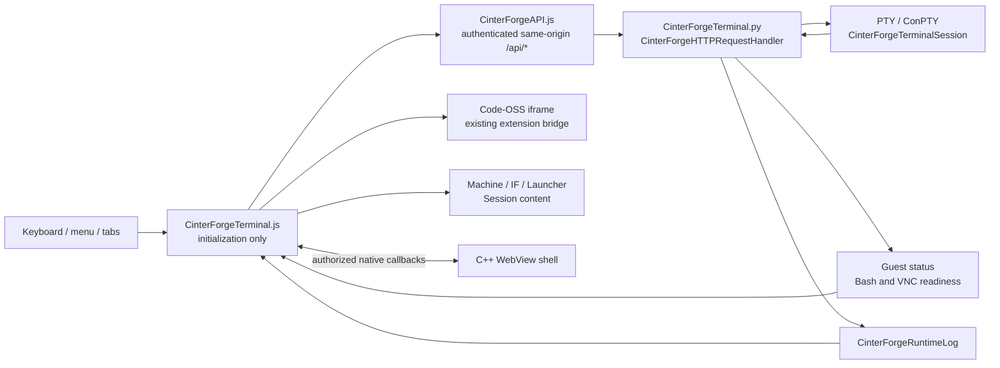

# CinterForge Terminal Client — Browser UI and JavaScript

**Primary orchestrator:** `webapp/CinterForgeTerminal.js`. **Owners:** `webapp/client/CinterForge*.js` (19 modules loaded in the documented order).  
**Supporting files:** `webapp/index.html`, `webapp/terminal.css`, `webapp/startup.js`, `webapp/launcher/`, `webapp/joshua/`, `webapp/data/`, `webapp/views/`, and the separately staged `webapp/codeoss/` workbench.  
**Scope:** current implemented split. The previous `webapp/terminal.js` no longer exists.

## Role and system boundary

The client is the **one served Terminal user interface** on Mac, Windows, Linux and supported LAN browsers. It renders tabs, terminal output, native-inspired menus, Code-OSS, machine emulators, the game/IF catalog, Bedrock EULA interactions, Discord and Launcher views. It does **not** own host processes or declare VM readiness. It asks the Python service to create/verify sessions and reads the resulting capability state. Native window, menu, clipboard and inspector operations use narrowly defined C++ WebView bindings when present.

## Browser owner responsibilities

| Area | Current code responsibilities |
| --- | --- |
| Authenticated bridge | `api()` sends same-origin JSON requests with the document-provided token; `nativeEvent()` reports authorized UI events to the WebView host |
| VT renderer | `VTOutput` consumes ANSI output, tracks cursor/scrollback, and renders the terminal surface |
| Global client state | Profile/catalog metadata, tab list, current session, `devtoolsInstalled`, `guestState`, `guestReady`, `guestVncReady` |
| Embedded computers | Code-OSS iframe and command bridge; Infinite Mac profiles and Lagomorph timing/boot sequence |
| Tab manager | Create, activate, close, preserve current output and focus per Session; tab order and persistence |
| Server Log | `openServerTab()` and `pollServerTab()` display the server's read-only rolling runtime log |
| Launchers | Windows/Linux/Mac launcher views and guest-backed staged-app requests; VNC availability must be independently verified |
| Games/IF/Discord | Separate session ownership for interpreters, save/restore, message history and command routing |
| PTY sessions | `openSession()`, `pollTab()`, `send()`, resize, close, reconnect and output generation/offset handling |
| Input, clipboard, keys | Focus/keyboard target, key translation, paste/copy and native clipboard integration |
| Menus | Shared menu actions, native/HTML menu dispatch, Code-OSS commands and action availability |
| Initialization and restoration | Fetch status and profiles, choose default Mac Bash, poll guest capabilities, restore only supported saved tabs |

## Architecture diagram

## Data flow: a shell keystroke

1. The user types into the focusable Terminal input. The client translates control keys and routes them to the **active tab**, not a global shell process.
2. `send()` uses the real terminal session ID and makes `/api/terminal/input` requests. The host-owned `CinterForgeTerminalSession` writes to its PTY/ConPTY (or verified guest PTY for that backend).
3. `pollTab()` requests `/api/terminal/poll` and uses its generation/offset to append output to the tab's renderer. A tab switch preserves the session and transcript without creating another worker.
4. Resize and close operations travel through `/api/terminal/resize` and `/api/terminal/close`. Code-OSS terminal requests use the existing `/host/code-shell-*` bridge and must not be confused with normal HTML Session tabs.

**Other flows:** Code-OSS is a same-origin workbench iframe and existing extension; Launcher actions request `/api/launcher/*`; game/IF, Bedrock and Discord use their dedicated `/api/*` routes. The Server Log tab reads `/api/server/log`; it is a view of server events, not a second logging engine.

## Startup and readiness

The script first calls `/api/status`, obtains the platform and installed DevTools/guest state, then loads `/data/terminal_styles.json` and `/data/mac_games.json`. It populates the shared profile/menu model and initializes tabs.

- **Mac without verified installed DevTools:** immediately open real **Mac Bash** Session mode. The optional guest VM is not required.
- **Mac with DevTools:** immediately open real **Mac Bash**; Server Log remains a background tab. Boot is managed by Python, not by JS; the UI polls `/api/lifecycle/guest-status` and displays live output without stealing focus.
- **Linux/Windows native app:** open the normal native terminal session.
- **Code-OSS, guest Bash, and VNC:** disabled until their **own live** readiness condition is met. Installation receipt, started VM, or active Docker container is not proof of a usable terminal or VNC socket.
- **Saved layout:** preserve the prior layout during the temporary Server Log view; reopen only the tabs whose connections have been established. A failed endpoint remains closed/unavailable while other healthy endpoints continue.

This is the intended contract and the current code already has separate `guestReady` and `guestVncReady` sets; the implementation should not reintroduce a single all-or-nothing readiness flag.

## Shutdown and reconnection

The browser saves its tab layout through `saveTerminalLayout()` and the `pagehide` hook. Switching or closing tabs should detach/close only the correct session; it must not stop another tab's shell or an app-owned VM. `beforeunload` is **not** the VM shutdown owner: Python and the native shell are. On the next launch, the client rehydrates the saved view only after server status says the endpoint is live. Connection failure must visibly update the menu and Server Log, not leave a blank VNC iframe or stale Code-OSS terminal.

## Browser module split — implemented

The old `webapp/terminal.js` has been removed. `webapp/CinterForgeTerminal.js` is the approximately 174-line final-loaded entry point for initial status, saved-tab restoration and DOM event registrations. All client behavior is in `webapp/client/CinterForge*.js` modules: API, VT renderer, capabilities, client state, Code-OSS, emulators, sessions, launchers, Discord, LAN, IF, session I/O, input, menus, layout, keyboard, Bedrock, guest status and commands. The modules share one `window.CinterForgeClientState` namespace and load in their original dependency order, not as competing UIs.

Both `index.html` and the Discord view use the same ordered script list. The Python HTTP static-file allowlist, embedded IF player, Host staging, Mac signing stage, release verifier and Xcode's authored resource copying all use the named files. Do not reintroduce `terminal.js`, separate browser state stores, or a second native transport.

## Maintenance contract and failure visibility

When changing the client, trace the whole action: UI event → API/binding → server state change → log/result → tab/menu state. Failures should show the endpoint, stage, cause, and the Server Log location. An empty VNC viewer is never a success state. Browser-only views must not pretend a local PTY or native capability exists. Never put tokens or secrets in JavaScript logs or persisted layouts.

**Related:** [Python server](CinterForgeTerminalServer.md), [native shell](../app/CinterForgeTerminal.md), [architecture](../docs/Architecture.md).

## All browser owners (completed refactor)

- `webapp/client/CinterForgeClientState.js` — component-owned UI code, loaded in declared original order
- `webapp/client/CinterForgeCodeOSS.js` — component-owned UI code, loaded in declared original order
- `webapp/client/CinterForgeEmulators.js` — component-owned UI code, loaded in declared original order
- `webapp/client/CinterForgeSessions.js` — component-owned UI code, loaded in declared original order
- `webapp/client/CinterForgeLaunchers.js` — component-owned UI code, loaded in declared original order
- `webapp/client/CinterForgeDiscord.js` — component-owned UI code, loaded in declared original order
- `webapp/client/CinterForgeLAN.js` — component-owned UI code, loaded in declared original order
- `webapp/client/CinterForgeIF.js` — component-owned UI code, loaded in declared original order
- `webapp/client/CinterForgeSessionIO.js` — component-owned UI code, loaded in declared original order
- `webapp/client/CinterForgeInput.js` — component-owned UI code, loaded in declared original order
- `webapp/client/CinterForgeMenus.js` — component-owned UI code, loaded in declared original order
- `webapp/client/CinterForgeLayout.js` — component-owned UI code, loaded in declared original order
- `webapp/client/CinterForgeKeyboard.js` — component-owned UI code, loaded in declared original order
- `webapp/client/CinterForgeBedrock.js` — component-owned UI code, loaded in declared original order
- `webapp/client/CinterForgeGuestStatus.js` — component-owned UI code, loaded in declared original order
- `webapp/client/CinterForgeCommands.js` — component-owned UI code, loaded in declared original order
- `webapp/CinterForgeTerminal.js` — thin browser startup entry; the old `terminal.js` is removed
