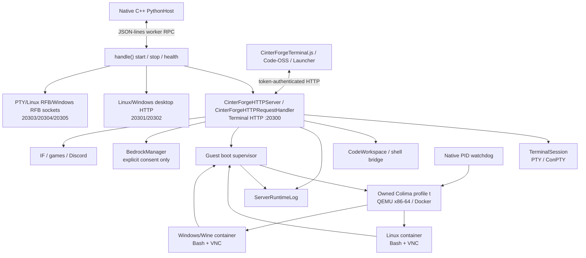

# CinterForge Terminal Server — Python Runtime and HTTP API

**Entry point:** `webapp/CinterForgeTerminal.py` (37 lines; `handle` and `main` dispatch only). **Implementations:** `webapp/runtime/CinterForge*.py`.  
**Entry/hosting:** staged `host/worker.py` and the native `PythonHost` C++ library; developer lifecycle remains under root `./Cinter` and `host/`.  
**Scope:** current runtime ownership split. There is one HTTP listener and one native-owned runtime, with lifecycle implementations separately under `host/`.

## What the server owns

The Python runtime owns the **real HTTP service**, validated API operations, PTY/ConPTY sessions, Server Log, LAN authentication/discovery, optional DevTools and VM guest readiness, Code-OSS shell/workspace integration, Bedrock management, game/IF orchestration, and on-demand staged-app launching. It does **not** draw the browser UI or own the native WebView. Setup/Build/Stage/Publish remain separate repository lifecycle commands; installing DevTools is an explicit in-app action, not a hidden startup Setup.

## Current source regions and owners

| Region/function/class | Responsibility |
| --- | --- |
| `main()`, `handle()` | Dispatch `--terminal-cli`, guest/watchdog modes and Host worker RPC methods (`start`, `stop`, `shutdown_runtime`, health/reboot) |
| `CinterForgeTerminalSession`, `CinterForgeBedrockTerminalSession` | PTY lifecycle, environment/working directory, bounded output and input/resize/close |
| `ServerRuntimeLog` | Persistent runtime events and bounded, cursor-based stream for Server Log |
| `CinterForgeHTTPServer`, `CinterForgeHTTPRequestHandler` | One `ThreadingHTTPServer`, same-origin static assets, HTTP request validation and `/api/*` routing |
| LAN login and `CinterForgeDiscovery` | Login/cookie/token behavior and DNS-SD advertisement of the actual port 20300 listener |
| `CodeWorkspace` and `/host/code-shell-*` | Existing Code-OSS workspace and reusable Linux/Windows shell bridge |
| IF/game/Discord helpers | Game catalogs, interpreter lifecycle, saves, remote channel integration |
| `CinterForgeBedrockManager` | Explicit EULA/download/install, worlds, dedicated-server lifecycle and console |
| `sdk_root()`, `install_devtools()` | Resolve/verify and explicitly install optional unified DevTools; show destination and progress |
| `_schedule_guest_boot()`, `_boot_guests_logged()` | App-owned guest supervisor starts only when the installed receipt is valid; publishes boot state and errors |
| `_new_owned_guest_shell()`, `_verify_persistent_guest_shell()` | Real reusable guest Bash connection, verified independently for Linux and Windows |
| `_check_owned_guest_vnc()`, `_verify_guest_vnc()`, `_launcher_*()` | Real VNC/noVNC checks and staged Linux/Windows GUI launch requests |
| `boot_runtime_guests()`, `stop_runtime_vm()`, `_runtime_watchdog_main()` | Managed `t` QEMU/Colima VM, one Docker daemon, guest containers, ownership and crash cleanup |

The old monolithic service has been replaced by named owner modules; the PythonHost RPC and HTTP API contracts remain stable.

## Ownership split

`webapp/CinterForgeTerminal.py` is the sole PythonHost/CLI entry point. It delegates the real work to the named modules under `webapp/runtime/`; it is no longer the location of HTTP dispatch, Bedrock, DevTools, VM boot, terminal session handling or shutdown. The single `CinterForgeHTTPServer` composes authorization and static-asset service (`CinterForgeHTTPAuthorization.py`), Code-OSS endpoints (`CinterForgeHTTPCode.py`), and API GET/POST routing (`CinterForgeHTTPRoutes.py`) into one `CinterForgeHTTPRequestHandler` with the existing token and URL contracts. It does not create a second listener.

`CinterForgeGuest.py` owns guest scheduling and independent Bash/VNC readiness. `CinterForgeVM.py` owns the existing Colima Docker state/boot implementation; `CinterForgeVMOperations.py`, `CinterForgeContainers.py`, and `CinterForgeGuestShells.py` own stop/guest-container/PTY operations. `CinterForgeRuntimeWatchdog.py` owns native-lifetime supervision. `CinterForgeService.py` owns the PythonHost RPC, not HTTP route methods.

All 22 runtime modules remain independent of `host` and `host/lifecycle`. Lifecycle has separately owned implementations and neither side imports the other. No VM argument, existing guest image, or release root was changed merely to effect this source split.

## VM configuration and boot

`runtime/CinterForgeVM.py` now defines `CinterForgeVM` and owns the existing
managed `t` profile's VM scratch-root selection (developer `Builds` versus
installed macOS cache), isolated Colima/Docker environment, cross-process
profile mutation lock, Mac host mounts, Colima YAML mount/emulation changes,
and `_ensure_docker_locked()` implementation. It retains the **same**
Colima start arguments, existing-profile checks, Docker architecture probes,
container-ownership guard, timeout, and readiness conditions. The class
receives the main service's logging, cancellation, guest-stop, and other
operations as explicit callbacks rather than importing the HTTP server.

Phase 4 replaces those old cross-layer wrappers and dependencies. The
application server now calls `CinterForgeVM` methods directly; no lifecycle
code imports `webapp/CinterForgeTerminal.py`, and the runtime does not import
`host` for the release identifier. The Setup/Build/Test `t` profile remains
under the same `Builds/CFTVM/T` path, but the lifecycle uses its own
`host/lifecycle/CinterForgeLifecycleVM.py` implementation. Lifecycle Test owns
its separate real guest/PTY/VNC acceptance operations in
`host/lifecycle/CinterForgeLifecycleGuests.py`. They intentionally share the
same configuration policy and image receipts while having **no Python source
or runtime service dependency** on one another. `host/mac/mac_bootstrap.py`
uses the lifecycle owner for interrupted-Setup cleanup, and the existing
`webapp/codeoss/extension` remains authored browser data while Code-OSS
acquisition/build producers live in `host/codeoss`.

This extraction is **not a fix or acceptance result** for the current
cloud-init/SSH native startup failure. Real macOS Colima, Bash and VNC
connections must still be observed before claiming recovery.

## Lifecycle/runtime ownership boundary

- **Runtime:** `webapp/CinterForgeTerminal.py` plus `webapp/runtime/CinterForgeVM.py`
  own only native-app HTTP, installed/developer session behavior, the runtime
  VM, guest connectivity, persistent shells, session state and shutdown. No
  imports from `host` or `host.lifecycle`; the developer release fallback
  is deliberately duplicated as a constant until a versioned data manifest
  becomes available.
- **Lifecycle:** `host/lifecycle/CinterForgeLifecycleVM.py` manages its own
  developer `t` profile under exactly the current `Builds/CFTVM/T` path.
  `host/lifecycle/CinterForgeLifecycleGuests.py` implements independent real
  Test acceptance of the pinned OCI image, Linux/Wine Bash PTYs, Xvfb, RFB
  and noVNC endpoints. It never constructs the application's HTTP server or
  imports an installed-app runtime class.
- **Build producer:** `host/codeoss/{setup,producer,adapters,extension_bundle}.py`
  owns Code-OSS acquisition and extension production; authored extension
  assets remain under `webapp/codeoss/extension/`. `./Cinter setup all`
  invokes the Host producer directly.
- **No changes to layout yet:** Colima profile `t`, Docker container name
  and label, developer VM scratch root, macOS installed-app cache, Steam
  logs, Bash commands, VNC ports and pinned guest images remain as before.
- **Explicitly unverified:** real macOS app startup and its Bash/VNC readiness
  have not been retested in this container. The separation is source-level,
  not a claim that the cloud-init/SSH regression is fixed.

## Architecture diagram

## Data flow and API contract

The staged worker imports this module and calls `handle("start", {"builds": ...})`. The server binds or securely reattaches to the existing listener, serves the authored `webapp/` assets from its own staged directory, and returns an authenticated URL and native bootstrap grant. `Handler` dispatches browser calls; privileged native/host actions are separately authorized.

| Request examples | Result/owner |
| --- | --- |
| `GET /api/status`, `GET /api/lifecycle/guest-status` | Platform and live capability/boot state for client menus and restoration |
| `POST /api/terminal/open`, `/input`, `/resize`, `/close`; `GET /api/terminal/poll` | Server-owned terminal session and bounded output |
| `GET /api/server/log` | Cursor-based read-only runtime log for the always-available Server Log tab |
| `/host/code-shell-open`, `/write`, `/resize`, `/close`, `/close-owner` | Real Code-OSS guest terminal connections, not simulated Mac Bash |
| `/api/launcher/start`, `/api/launcher/launch` | Verified VNC desktop and staged application launch requests |
| `/api/lifecycle/guest-boot`, `/api/lifecycle/reboot` | Explicit managed boot/reboot operations; runtime reboot must not build or provision |
| `/api/bedrock/*`, `/api/if/*`, `/api/discord/*`, `/api/lan/*` | Dedicated services with independent state/security rules |

PTY output moves from an actual process into `CinterForgeTerminalSession` buffers and the HTTP polling response. Guest status is *observed* by Python and read by JS; a receipt, a Docker container ID, an open VNC iframe or Code-OSS menu action cannot declare readiness.

## Startup: native shell through usable guests

1. The C++ Host starts the Python worker and calls `handle('start', ...)`. The server resolves the staged asset closure and the correct writable runtime/log roots; it starts the authenticated HTTP service.
2. Mac Bash is available without DevTools. If receipt-verified DevTools are installed, Python schedules optional guest startup **asynchronously**; the first client view can open Mac Bash immediately while Server Log captures guest boot in the background.
3. The one app-owned `t` Colima/QEMU VM comes up with configured host volumes, then Docker and the retained Linux/Windows containers are checked. Serial and host-agent output should be mirrored into the visible runtime log while booting, including timeout/exit evidence.
4. Each **VNC endpoint** is verified independently via the real RFB/noVNC connection. Each **persistent Bash PTY** is also verified independently; failure of one does not revoke the other. State includes `guest_start_state`, `guest_ready`, `guest_vnc_ready` and `guest_errors`.
5. `/api/lifecycle/guest-status` publishes these verified capabilities. Only then may JS enable each Code/guest terminal/VNC menu action or restore its saved tab.

**Important distinction:** A successful runtime SSH/Colima boot is not proof that Linux WebKitGTK libraries exist or that a Windows staged launcher responds. Guest connection, desktop connection and **application launch** require separate results and logs.

## Shutdown, crash and reboot ownership

`handle('stop')` stops HTTP/session work. The owning native process requests `shutdown_runtime`; the runtime closes persistent guest shells, stops the app-owned containers and `t` VM, and releases owned helpers. An independent watchdog monitors the native process and performs cleanup after a crash or debugger Stop. An attached window or unrelated process must not kill another owner's VM. During reboot, capability states return to unavailable and become ready only after the *new* connection succeeds; the service must avoid overlapping VM owners and stale PTYs.

The developer `./Cinter` Setup uses its own managed infrastructure and must stop its owned VMs when done. It must not silently provision on ordinary app launch. Console progress and durable logs are part of this runtime behavior, not replacements for actual readiness.

## Current module boundaries

HTTP: `CinterForgeHTTP`, `CinterForgeHTTPAuthorization`, `CinterForgeHTTPCode`, `CinterForgeHTTPRoutes`. Session and authentication: `CinterForgeSessions`, `CinterForgeAuthentication`, `CinterForgeDiscovery`, `CinterForgeLogging`. Guest and native lifetime: `CinterForgeGuest`, `CinterForgeGuestShells`, `CinterForgeVM`, `CinterForgeVMOperations`, `CinterForgeContainers`, `CinterForgeRuntimeWatchdog`, `CinterForgeRuntimeBootstrap`. Features: `CinterForgeBedrock`, `CinterForgeCode`, `CinterForgeCommands`, `CinterForgeDiscord`, `CinterForgeIF`, `CinterForgeLaunchers`, `CinterForgeDevTools`. Entrypoints/configuration: `CinterForgeApplication`, `CinterForgeService`, `CinterForgeSettings`.

The extraction changes code ownership, not runtime success criteria. Mac Bash remains independent of optional guest boot, and each guest Bash/VNC endpoint must be live-verified. Nothing here proves the prior native guest connection regression is repaired.

### Recommended connection diagnosis sequence

For a failure, follow the first broken boundary in the existing Server Log: **native worker → HTTP readiness → Colima/QEMU boot → SSH/Docker → container → Bash PTY → RFB/noVNC → staged Linux/Windows app process**. Preserve raw exit codes, image/runtime versions and the relevant process log in one place. Do not respond to a Bash failure by revoking a healthy VNC connection or trying to reconstruct a whole VM without evidence. This makes subsequent refactoring diagnostic rather than speculative.

**Related:** [JavaScript client](CinterForgeTerminalClient.md), [native application shell](../app/CinterForgeTerminal.md), [architecture](../docs/Architecture.md).

## Complete application-server owner split

- `webapp/runtime/CinterForgeApplication.py` — independent app-owned Python component; callers use explicit module methods
- `webapp/runtime/CinterForgeAuthentication.py` — independent app-owned Python component; callers use explicit module methods
- `webapp/runtime/CinterForgeBedrock.py` — independent app-owned Python component; callers use explicit module methods
- `webapp/runtime/CinterForgeCode.py` — independent app-owned Python component; callers use explicit module methods
- `webapp/runtime/CinterForgeCommands.py` — independent app-owned Python component; callers use explicit module methods
- `webapp/runtime/CinterForgeContainers.py` — independent app-owned Python component; callers use explicit module methods
- `webapp/runtime/CinterForgeDevTools.py` — independent app-owned Python component; callers use explicit module methods
- `webapp/runtime/CinterForgeDiscord.py` — independent app-owned Python component; callers use explicit module methods
- `webapp/runtime/CinterForgeDiscovery.py` — independent app-owned Python component; callers use explicit module methods
- `webapp/runtime/CinterForgeGuest.py` — independent app-owned Python component; callers use explicit module methods
- `webapp/runtime/CinterForgeGuestShells.py` — independent app-owned Python component; callers use explicit module methods
- `webapp/runtime/CinterForgeHTTPAuthorization.py` — authentication, static assets, response helpers and request audit
- `webapp/runtime/CinterForgeHTTPCode.py` — Code-OSS-specific HTTP endpoints
- `webapp/runtime/CinterForgeHTTPRoutes.py` — authenticated GET/POST API request dispatch
- `webapp/runtime/CinterForgeHTTP.py` — independent app-owned Python component; callers use explicit module methods
- `webapp/runtime/CinterForgeIF.py` — independent app-owned Python component; callers use explicit module methods
- `webapp/runtime/CinterForgeLaunchers.py` — independent app-owned Python component; callers use explicit module methods
- `webapp/runtime/CinterForgeLogging.py` — independent app-owned Python component; callers use explicit module methods
- `webapp/runtime/CinterForgeRuntimeBootstrap.py` — independent app-owned Python component; callers use explicit module methods
- `webapp/runtime/CinterForgeRuntimeWatchdog.py` — independent app-owned Python component; callers use explicit module methods
- `webapp/runtime/CinterForgeService.py` — independent app-owned Python component; callers use explicit module methods
- `webapp/runtime/CinterForgeSessions.py` — independent app-owned Python component; callers use explicit module methods
- `webapp/runtime/CinterForgeSettings.py` — independent app-owned Python component; callers use explicit module methods
- `webapp/runtime/CinterForgeVM.py` — independent app-owned Python component; callers use explicit module methods
- `webapp/runtime/CinterForgeVMOperations.py` — independent app-owned Python component; callers use explicit module methods
`webapp/CinterForgeTerminal.py` remains the 37-line PythonHost/CLI entry. No lifecycle code is imported.
**Runtime connection status:** live Bash/VNC still requires macOS acceptance; the refactor is not a boot fix.

## Browser network ports

The application-owned HTTP/API listener is **20300**. A Linux VNC webpage is
served on **20301**, a Windows VNC webpage on **20302**. The interactive
Terminal PTY WebSocket is **20303**, the Linux VNC WebSocket **20304**, and the
Windows VNC WebSocket **20305**. All six are reachable on the hosting LAN IP
while the Terminal owns the services. There is no extra VM or container.
The existing Docker localhost-forwarded noVNC endpoints (20601/20602) remain
internal transport backends and are not browser addresses. Actual native
Linux/Windows guest application HTTP servers use individually assigned guest
loopback ports to avoid stealing the parent Terminal's 20300 listener.

A mapped guest X11 window is not by itself a successful browser display.
The page reports connection only after noVNC has established its RFB session.
Closing the native owner closes the two HTTP viewers and three WebSockets.
