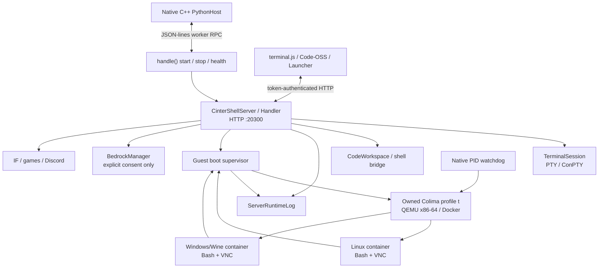

# CinterForge Terminal Server — Python Runtime and HTTP API

**Primary source:** `webapp/CinterForgeTerminal.py` (the current single-file service).  
**Entry/hosting:** staged `host/worker.py` and the native `PythonHost` C++ library; developer lifecycle remains under root `./Cinter` and `host/`.  
**Scope:** current implementation, runtime data flow and proposed refactor. No new server or implementation is introduced by this document.

## What the server owns

The Python runtime owns the **real HTTP service**, validated API operations, PTY/ConPTY sessions, Server Log, LAN authentication/discovery, optional DevTools and VM guest readiness, Code-OSS shell/workspace integration, Bedrock management, game/IF orchestration, and on-demand staged-app launching. It does **not** draw the browser UI or own the native WebView. Setup/Build/Stage/Publish remain separate repository lifecycle commands; installing DevTools is an explicit in-app action, not a hidden startup Setup.

## Current source regions and owners

| Region/function/class | Responsibility |
| --- | --- |
| `main()`, `handle()` | Dispatch `--terminal-cli`, guest/watchdog modes and Host worker RPC methods (`start`, `stop`, `shutdown_runtime`, health/reboot) |
| `TerminalSession`, `BedrockTerminalSession` | PTY lifecycle, environment/working directory, bounded output and input/resize/close |
| `ServerRuntimeLog` | Persistent runtime events and bounded, cursor-based stream for Server Log |
| `CinterShellServer`, `Handler` | One `ThreadingHTTPServer`, same-origin static assets, HTTP request validation and `/api/*` routing |
| LAN login and `CinterForgeDiscovery` | Login/cookie/token behavior and DNS-SD advertisement of the actual port 20300 listener |
| `CodeWorkspace` and `/host/code-shell-*` | Existing Code-OSS workspace and reusable Linux/Windows shell bridge |
| IF/game/Discord helpers | Game catalogs, interpreter lifecycle, saves, remote channel integration |
| `BedrockManager` | Explicit EULA/download/install, worlds, dedicated-server lifecycle and console |
| `sdk_root()`, `install_devtools()` | Resolve/verify and explicitly install optional unified DevTools; show destination and progress |
| `_schedule_guest_boot()`, `_boot_guests_logged()` | App-owned guest supervisor starts only when the installed receipt is valid; publishes boot state and errors |
| `_new_owned_guest_shell()`, `_verify_persistent_guest_shell()` | Real reusable guest Bash connection, verified independently for Linux and Windows |
| `_check_owned_guest_vnc()`, `_verify_guest_vnc()`, `_launcher_*()` | Real VNC/noVNC checks and staged Linux/Windows GUI launch requests |
| `boot_runtime_guests()`, `stop_runtime_vm()`, `_runtime_watchdog_main()` | Managed `t` QEMU/Colima VM, one Docker daemon, guest containers, ownership and crash cleanup |

The 8,000-plus-line service mixes HTTP routing with system lifecycle operations; that is an ownership problem to address incrementally, not a reason to replace the live implementation.

## Architecture diagram

## Data flow and API contract

The staged worker imports this module and calls `handle("start", {"builds": ...})`. The server binds or securely reattaches to the existing listener, serves the authored `webapp/` assets from its own staged directory, and returns an authenticated URL and native bootstrap grant. `Handler` dispatches browser calls; privileged native/host actions are separately authorized.

| Request examples | Result/owner |
| --- | --- |
| `GET /api/status`, `GET /api/lifecycle/guest-status` | Platform and live capability/boot state for client menus and restoration |
| `POST /api/terminal/open`, `/input`, `/resize`, `/close`; `GET /api/terminal/poll` | Server-owned terminal session and bounded output |
| `GET /api/server/log` | Cursor-based read-only runtime log for the always-available Server Log tab |
| `/host/code-shell-open`, `/write`, `/resize`, `/close`, `/close-owner` | Real Code-OSS guest terminal connections, not simulated Mac Bash |
| `/api/launcher/start`, `/api/launcher/launch` | Verified VNC desktop and staged application launch requests |
| `/api/lifecycle/guest-boot`, `/api/lifecycle/reboot` | Explicit managed boot/reboot operations; runtime reboot must not build or provision |
| `/api/bedrock/*`, `/api/if/*`, `/api/discord/*`, `/api/lan/*` | Dedicated services with independent state/security rules |

PTY output moves from an actual process into `TerminalSession` buffers and the HTTP polling response. Guest status is *observed* by Python and read by JS; a receipt, a Docker container ID, an open VNC iframe or Code-OSS menu action cannot declare readiness.

## Startup: native shell through usable guests

1. The C++ Host starts the Python worker and calls `handle('start', ...)`. The server resolves the staged asset closure and the correct writable runtime/log roots; it starts the authenticated HTTP service.
2. Mac Bash is available without DevTools. If receipt-verified DevTools are installed, Python schedules optional guest startup **asynchronously**; the first client view can render Server Log immediately.
3. The one app-owned `t` Colima/QEMU VM comes up with configured host volumes, then Docker and the retained Linux/Windows containers are checked. Serial and host-agent output should be mirrored into the visible runtime log while booting, including timeout/exit evidence.
4. Each **VNC endpoint** is verified independently via the real RFB/noVNC connection. Each **persistent Bash PTY** is also verified independently; failure of one does not revoke the other. State includes `guest_start_state`, `guest_ready`, `guest_vnc_ready` and `guest_errors`.
5. `/api/lifecycle/guest-status` publishes these verified capabilities. Only then may JS enable each Code/guest terminal/VNC menu action or restore its saved tab.

**Important distinction:** A successful runtime SSH/Colima boot is not proof that Linux WebKitGTK libraries exist or that a Windows staged launcher responds. Guest connection, desktop connection and **application launch** require separate results and logs.

## Shutdown, crash and reboot ownership

`handle('stop')` stops HTTP/session work. The owning native process requests `shutdown_runtime`; the runtime closes persistent guest shells, stops the app-owned containers and `t` VM, and releases owned helpers. An independent watchdog monitors the native process and performs cleanup after a crash or debugger Stop. An attached window or unrelated process must not kill another owner's VM. During reboot, capability states return to unavailable and become ready only after the *new* connection succeeds; the service must avoid overlapping VM owners and stale PTYs.

The developer `./Cinter` Setup uses its own managed infrastructure and must stop its owned VMs when done. It must not silently provision on ordinary app launch. Console progress and durable logs are part of this runtime behavior, not replacements for actual readiness.

## Refactor proposal — one runtime, smaller responsibilities

Split along stable **internal** module boundaries while keeping this module as the public service entry and preserving current routes and worker RPC names:

| Future internal owner | Extract from | Public behavior to preserve |
| --- | --- | --- |
| `runtime/CinterForgeHTTP.py` | `CinterShellServer`, `Handler`, auth and route dispatch | Existing `GET`/`POST` routes, response shapes, tokens, LAN policy |
| `runtime/CinterForgeSessions.py` | `TerminalSession` and shell environment | Real PTY behavior, session IDs, output cursors and shutdown |
| `runtime/CinterForgeGuest.py` | Boot/stop/watchdog and owned Colima/Docker processes | Single `t` VM; one Docker daemon; verified per-endpoint readiness |
| `runtime/CinterForgeLaunchers.py` | Guest VNC and staged GUI launch logic | Connection verification and actionable launch errors |
| `runtime/CinterForgeCode.py` | `CodeWorkspace`/guest shell bridge | Same Code-OSS interface, no duplicate shells |
| `runtime/CinterForgeLogging.py` | `ServerRuntimeLog` and producer diagnostics | One visible `Logs/CinterForgeTerminal` tree per execution context |
| Feature-owned modules | CinterForgeBedrock, CinterForgeIF, CinterForgeLagomorph, CinterForgeDiscord | Same opt-in, installed paths, existing game/IF behaviors |

Start by specifying the current runtime objects and **their ownership**, then lift one coherent region into a module without changing its API or lifecycle behavior. Do not recreate a second HTTP server, platform VM manager, JSON model, test harness or preflight. The existing `./Cinter` lifecycle and real installed app are the integration path. Keep Setup provisioning separate from Build, Stage, Test and app Runtime. Keep generated outputs under sibling Builds or the selected Steam installation, never inside source.

### Recommended connection diagnosis sequence

For a failure, follow the first broken boundary in the existing Server Log: **native worker → HTTP readiness → Colima/QEMU boot → SSH/Docker → container → Bash PTY → RFB/noVNC → staged Linux/Windows app process**. Preserve raw exit codes, image/runtime versions and the relevant process log in one place. Do not respond to a Bash failure by revoking a healthy VNC connection or trying to reconstruct a whole VM without evidence. This makes subsequent refactoring diagnostic rather than speculative.

**Related:** [JavaScript client](CinterForgeTerminalClient.md), [native application shell](../app/CinterForgeTerminal.md), [architecture](../docs/Architecture.md).
